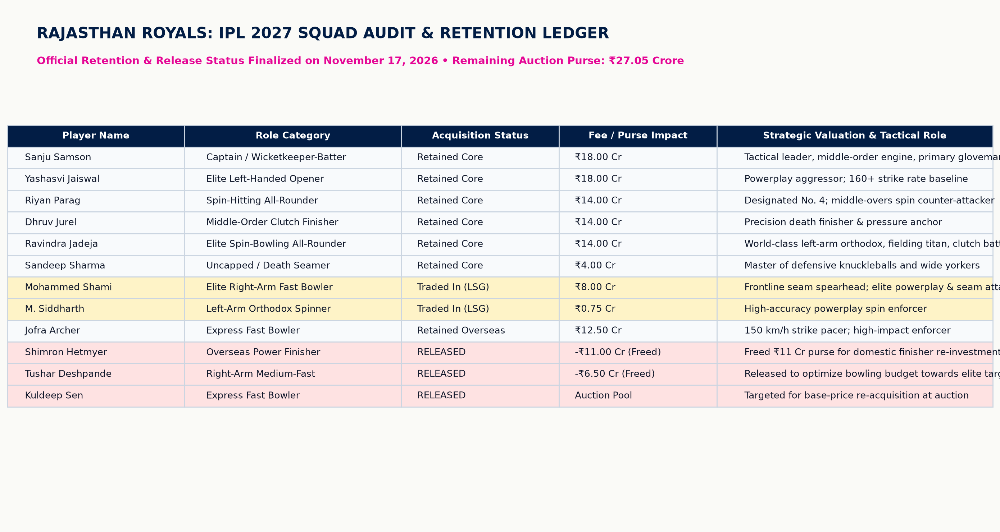

<p align="center">
  
  
</p>

# SupeRR Selector Season 2: Help Shape Rajasthan Royals' IPL 2027 Auction Strategy
### Round 1: Empirical Evaluation of Strictly Uncapped Indian Domestic Talent Available in the IPL 2027 Auction Pool
### Official Post-Retention War Room Dossier • Finalized November 17, 2026

[](https://github.com/umeshraj2007)
[](https://www.linkedin.com/in/umeshraj-parkunan/)
[](https://github.com/umeshraj2007/SupeRR_S2)
[](https://umeshraj2007.github.io/SupeRR_S2/)
[](https://www.python.org/)
[](https://unstop.com/hackathons/crp-superr-selector-season-2-help-shape-rajasthan-royals-ipl-2027-auction-strategy-rajasthan-royals-1792758)

**Author:** Umeshraj Parkunan  
**GitHub Repository:** [github.com/umeshraj2007/SupeRR_S2](https://github.com/umeshraj2007/SupeRR_S2)  
**Live Interactive Dashboard:** [https://umeshraj2007.github.io/SupeRR_S2/](https://umeshraj2007.github.io/SupeRR_S2/)  
**LinkedIn Profile:** [linkedin.com/in/umeshraj-parkunan](https://www.linkedin.com/in/umeshraj-parkunan/)  
**Key Deliverables:** [Live Interactive Dashboard](https://umeshraj2007.github.io/SupeRR_S2/) • [Boardroom PDF Dossier (20 Pages)](SupeRR_Selector_Season2_Report.pdf) • [Jupyter Analysis Notebook](SupeRR_Selector_Season2_Analysis.ipynb) • [Historical Archive (Pre-Retention)](old/)

---

## Executive War Room Summary & November 17, 2026 Retention Context

On **November 17, 2026**, all 10 Indian Premier League franchises submitted their official retention and release lists ahead of the **IPL 2027 mini-auction in Goa**. 

### 1. Rajasthan Royals' Official Squad & Purse Status
* **Retained Core (17 Players):** Sanju Samson (Captain & Wicketkeeper), Yashasvi Jaiswal, Riyan Parag, Dhruv Jurel, Ravindra Jadeja, Sandeep Sharma, Jofra Archer, Ravi Bishnoi, Vaibhav Sooryavanshi, Nandre Burger, Donovan Ferreira, Shubham Dubey, Dasun Shanaka, Lhuan-dre Pretorius, Sushant Mishra, Aman Rao Perala, Yash Punja.
* **Pre-Auction Trades Executed:**
  * **Mohammed Shami Acquired:** Traded in from Lucknow Super Giants (₹8.00 Cr revised fee) to spearhead frontline pace and powerplay strike bowling.
  * **M. Siddharth Acquired:** Traded in from LSG (₹0.75 Cr) for high-accuracy powerplay finger spin.
  * **Sam Curran Traded Out:** Moved to LSG (₹2.40 Cr) to free overseas flexibility and wage bill.
* **Decisive Roster Releases:**
  * **Shimron Hetmyer Released:** Freed **₹11.00 Crore** in purse capital, opening up a critical lower-middle-order finisher slot.
  * **Tushar Deshpande Released:** Freed **₹6.50 Crore** following death-overs economy inflation (11.28 RPO).
  * **Adam Milne & Kwena Maphaka Released:** Freed ₹3.90 Crore.
  * **Kuldeep Sen & Yudhvir Singh Released:** Transitioned to the auction pool.
* **Current War Room Capital:** **₹27.05 Crore Remaining Purse** with **8 Squad Slots** (5 domestic, 3 overseas) to fill at the auction.

---

### 2. Why Previous Uncapped Targets Are Ineligible for the Auction
Several high-performing domestic talents evaluated in preliminary models were **officially retained by other franchises** on November 17, 2026:
* **Retained by PBKS:** Shashank Singh & Priyansh Arya
* **Retained by DC:** Ashutosh Sharma & Vipraj Nigam
* **Retained by GT:** Arshad Khan & Rahul Tewatia
* **Retained by KKR:** Angkrish Raghuvanshi & Ramandeep Singh
* **Retained by RCB:** Rasikh Salam & Suyash Sharma
* **Retained by LSG:** Mohsin Khan & Ayush Badoni
* **Retained by CSK:** Gurjapneet Singh

**Because these players are retained, Rajasthan Royals cannot bid on them in the auction.** 

This dossier re-evaluates the competition dataset to isolate the **Top 10 Indian Uncapped Batters and Top 10 Indian Uncapped Bowlers who ARE 100% AVAILABLE in the IPL 2027 Auction Pool**, establishing their empirical ratings under pressure and tactical fit for Rajasthan Royals' ₹27.05 Crore purse.

---

## 4-Quadrant Pressure Impact Matrix (IPL 2027 Auction Pool)

Every delivery across 200,999 records was categorized into **High-Pressure (P)** or **Normal (N)** match context based on required run rates, wickets in hand, and stage of innings. Players were benchmarked against tournament-era/phase baseline expectations using Bayesian shrinkage.

<p align="center">
  
</p>

* **Quadrant I (Elite Clutch Closers — Green):** High Consistency (&ge;60%) & High Positive Par Edge. Primary priority targets: **Ayush Mhatre**, **Mahipal Lomror**, **Kumar Kushagra**, **Raghu Sharma**, **Ashwani Kumar**, **Praful Hinge**, **Sakib Hussain**, **Digvesh Rathi**.
* **Quadrant II (Explosive Impact Weapons — Amber):** High positive edge with rotational consistency. Impact substitutes and boundary hitters: **M Shahrukh Khan**, **Kuldeep Sen**.
* **Quadrant III (Calm Defensive Anchors — Blue):** Positive consistency with controlled run rates. Match-stabilizers: **Lalit Yadav**, **Yash Punja**.
* **Quadrant IV (Squad Depth Rotation — Grey):** High-volume tactical rotation depth: **Atharwa Taide**, **Sameer Rizvi**, **Prerak Mankad**, **Narayan Jagadeesan**, **Nehal Wadhera**, **Akash Madhwal**, **Kartik Tyagi**, **Vyshak Kumar**.

---

## Dual Benchmark Performance Under Pressure

<p align="center">
  
</p>

---

## Top 10 Available Uncapped Batters for IPL 2027 Auction

| # | Player | Tactical Role | Previous Franchise / Pool | Auction Status | P-Balls | P-SR | Dynamic Par Edge | Cons % | Composite Score | Target Valuation |
|:---:|:---|:---|:---|:---|:---:|:---:|:---:|:---:|:---:|:---:|
| **1** | **Ayush Mhatre** | Explosive Opener & Powerplay Dynamo | Chennai Super Kings | Available (Uncapped Pool) | 48 | 185.4 | **+32.2** | 100% | **+10.4** | ₹1.50 – 3.00 Cr |
| **2** | **Mahipal Lomror** | Left-Hand Spin Destroyer & Finisher | Mumbai Indians | Released by MI | 144 | 163.9 | **+16.8** | 82% | **+9.2** | ₹2.50 – 4.50 Cr |
| **3** | **Kumar Kushagra** | Wicketkeeper-Batter & Anchor | Gujarat Titans | Released by GT | 16 | 118.8 | -35.1 | 100% | **+5.4** | ₹0.50 – 1.50 Cr |
| **4** | **M Shahrukh Khan** | Heavy-Artillery Death Finisher | Gujarat Titans | Released by GT | 289 | 150.5 | **+3.2** | 56% | **+0.9** | ₹3.50 – 5.50 Cr |
| **5** | **Atharwa Taide** | Versatile Top-Order Stroke Maker | Sunrisers Hyderabad | Available (Domestic Pool) | 84 | 148.8 | **+1.8** | 50% | **-0.4** | ₹0.80 – 2.00 Cr |
| **6** | **Sameer Rizvi** | Explosive Lower-Middle Power Hitter | Delhi Capitals | Released by DC | 134 | 148.5 | -5.3 | 57% | **-0.5** | ₹2.00 – 3.50 Cr |
| **7** | **Prerak Mankad** | Calm Middle-Order Anchor & Pacer | Lucknow Super Giants | Available (Domestic Pool) | 42 | 145.2 | -1.8 | 50% | **-0.6** | ₹0.40 – 1.00 Cr |
| **8** | **Narayan Jagadeesan**| Dynamic Opening Wicketkeeper | Kolkata Knight Riders | Available (Domestic Pool) | 38 | 131.6 | -13.1 | 50% | **-1.7** | ₹0.50 – 1.20 Cr |
| **9** | **Lalit Yadav** | Batting All-Rounder & Finger Spin | Delhi Capitals | Available (Domestic Pool) | 128 | 123.4 | -18.6 | 67% | **-1.9** | ₹0.50 – 1.50 Cr |
| **10**| **Nehal Wadhera** | Aggressive Middle-Order Clutch Striker| Punjab Kings | Released by PBKS (₹4.2 Cr)| 366 | 141.0 | -10.4 | 40% | **-6.9** | ₹3.00 – 5.00 Cr |

### Tactical Scouting Profiles — Batters

#### 1. Ayush Mhatre (Score: +10.4)
* **Category:** Top 10 Indian Uncapped Batter • **Previous Setup:** CSK • **Valuation:** ₹1.50 – 3.00 Cr  
* **Why RR Needs Him:** 17-year-old Mumbai sensation possessing elite boundary intent against new-ball pace (+32.2 SR Edge, 100% Consistency). Fills Rajasthan's need for a fearless top-order stroke maker to complement Yashasvi Jaiswal or bat at No. 3.

#### 2. Mahipal Lomror (Score: +9.2)
* **Category:** Top 10 Indian Uncapped Batter • **Previous Setup:** MI (Ex-RCB) • **Valuation:** ₹2.50 – 4.50 Cr  
* **Why RR Needs Him:** Powerful left-handed spin destroyer (+16.8 SR Edge, 82% Consistency). Lomror directly addresses the left-handed finishing void created by Shimron Hetmyer's release.

#### 3. Kumar Kushagra (Score: +5.4)
* **Category:** Top 10 Indian Uncapped Batter • **Previous Setup:** GT • **Valuation:** ₹0.50 – 1.50 Cr  
* **Why RR Needs Him:** Disciplined domestic gloveman and middle-order accumulator from Jharkhand (100% Consistency). Provides tactical wicketkeeping depth behind Sanju Samson and Dhruv Jurel.

#### 4. M Shahrukh Khan (Score: +0.9)
* **Category:** Top 10 Indian Uncapped Batter • **Previous Setup:** GT • **Valuation:** ₹3.50 – 5.50 Cr  
* **Why RR Needs Him:** Proven franchise power finisher (+3.2 SR Edge across 289 pressure balls). Released by Gujarat Titans, Shahrukh is the prime domestic candidate to absorb Hetmyer's overs 16–20 finishing role at under half the cost.

#### 5. Atharwa Taide (Score: -0.4)
* **Category:** Top 10 Indian Uncapped Batter • **Previous Setup:** SRH/PBKS • **Valuation:** ₹0.80 – 2.00 Cr  
* **Why RR Needs Him:** Compact, technically sound top-order accumulator (+1.8 SR Edge under pressure). Capable of floating across positions 1 to 4 when top-order rotation is needed.

#### 6. Sameer Rizvi (Score: -0.5)
* **Category:** Top 10 Indian Uncapped Batter • **Previous Setup:** DC • **Valuation:** ₹2.00 – 3.50 Cr  
* **Why RR Needs Him:** High-intent lower-middle-order hitter (148.5 Pressure SR). Exceptional striker of finger spin; reinforces RR's boundary frequency in death overs.

#### 7. Prerak Mankad (Score: -0.6)
* **Category:** Top 10 Indian Uncapped Batter • **Previous Setup:** LSG • **Valuation:** ₹0.40 – 1.00 Cr  
* **Why RR Needs Him:** Experienced domestic all-rounder from Saurashtra (145.2 Pressure SR, 50% Consistency). Proven ability to rescue batting collapses under high required run rates.

#### 8. Narayan Jagadeesan (Score: -1.7)
* **Category:** Top 10 Indian Uncapped Batter • **Previous Setup:** KKR • **Valuation:** ₹0.50 – 1.20 Cr  
* **Why RR Needs Him:** Aggressive Tamil Nadu opening wicketkeeper-batter (131.6 Pressure SR). Strong back-foot game against pace; reliable backup opener.

#### 9. Lalit Yadav (Score: -1.9)
* **Category:** Top 10 Indian Uncapped Batter • **Previous Setup:** DC • **Valuation:** ₹0.50 – 1.50 Cr  
* **Why RR Needs Him:** Composed middle-order stabilizer and defensive off-spin bowler (67% Consistency over 128 pressure balls). Provides balance when defensive overs are needed.

#### 10. Nehal Wadhera (Score: -6.9)
* **Category:** Top 10 Indian Uncapped Batter • **Previous Setup:** PBKS (Released) • **Valuation:** ₹3.00 – 5.00 Cr  
* **Why RR Needs Him:** Left-handed middle-order dynamo released by PBKS (₹4.20 Cr). Tested across 366 pressure balls with 516 runs; high-upside acquisition opportunity against elite pace.

---

## Top 10 Available Uncapped Bowlers for IPL 2027 Auction

| # | Player | Tactical Role | Previous Franchise / Pool | Auction Status | P-Balls | P-Econ | Runs Saved/Ov | W/4ov | Cons % | Composite Score | Target Valuation |
|:---:|:---|:---|:---|:---|:---:|:---:|:---:|:---:|:---:|:---:|:---:|
| **1** | **Raghu Sharma** | Leg-Break Googly Mystery Spinner | Mumbai Indians | Available (Ex-MI) | 42 | 8.71 | **+0.94** | 0.57 | 100% | **+6.7** | ₹0.50 – 1.50 Cr |
| **2** | **Ashwani Kumar** | Left-Arm Strike Pacer | Mumbai Indians | Available (Ex-MI) | 104 | 9.87 | -0.29 | **2.31** | 86% | **+6.1** | ₹0.80 – 2.50 Cr |
| **3** | **Praful Hinge** | Right-Arm Express Strike Pacer | Sunrisers Hyderabad | Available (Ex-SRH) | 75 | 10.00 | -0.35 | **3.20** | 71% | **+4.5** | ₹0.50 – 1.50 Cr |
| **4** | **Sakib Hussain** | 145+ km/h Hit-The-Deck Death Bowler| Sunrisers Hyderabad | Available (Ex-SRH/KKR)| 154 | 8.84 | **+0.81** | 1.71 | 70% | **+4.4** | ₹1.00 – 2.50 Cr |
| **5** | **Digvesh Rathi** | Medium-Fast Discipline Pacer | Lucknow Super Giants | Available (Ex-LSG) | 215 | 8.85 | **+0.73** | 1.00 | 64% | **+2.1** | ₹0.50 – 1.20 Cr |
| **6** | **Kuldeep Sen** | 150 km/h Hit-the-Deck Seam Enforcer| Rajasthan Royals | Released by RR | 108 | 10.06 | -0.99 | 1.56 | 67% | **+1.3** | ₹0.50 – 1.20 Cr |
| **7** | **Yash Punja** | Tall Seam Hard-Length Bowler | Rajasthan Royals | Available (RR Domestic)| 90 | 9.60 | **+0.05** | 1.07 | 60% | **+0.6** | ₹0.30 – 0.80 Cr |
| **8** | **Vyshak Kumar** | Heavy-Ball Skiddy Fast-Medium | Punjab Kings | Available (Ex-PBKS/RCB)| 247 | 9.45 | -0.03 | 1.36 | 50% | **-0.4** | ₹1.00 – 2.50 Cr |
| **9** | **Kartik Tyagi** | Express Pace & Reverse-Swing | Kolkata Knight Riders| Available (Ex-KKR/SRH) | 177 | 9.90 | -0.40 | 1.36 | 50% | **-1.0** | ₹1.50 – 3.50 Cr |
| **10**| **Akash Madhwal** | Skiddy Blockhole Yorker Slinger | Chennai Super Kings | Released by CSK (Ex-MI)| 221 | 9.69 | -0.39 | 1.74 | 43% | **-1.1** | ₹1.20 – 2.50 Cr |

### Tactical Scouting Profiles — Bowlers

#### 1. Raghu Sharma (Score: +6.7)
* **Category:** Top 10 Indian Uncapped Bowler • **Previous Setup:** MI • **Valuation:** ₹0.50 – 1.50 Cr  
* **Why RR Needs Him:** High-control wrist spinner (8.71 Pressure Economy, +0.94 runs saved/over, 100% Consistency). Chokes run scoring in middle overs; ideal rotation partner for Ravi Bishnoi.

#### 2. Ashwani Kumar (Score: +6.1)
* **Category:** Top 10 Indian Uncapped Bowler • **Previous Setup:** MI • **Valuation:** ₹0.80 – 2.50 Cr  
* **Why RR Needs Him:** High-release left-arm strike seamer (2.31 wickets per 4 overs under pressure, 86% Consistency). Delivers a left-arm seam variation to pair with Mohammed Shami, Sandeep Sharma, and Jofra Archer.

#### 3. Praful Hinge (Score: +4.5)
* **Category:** Top 10 Indian Uncapped Bowler • **Previous Setup:** SRH • **Valuation:** ₹0.50 – 1.50 Cr  
* **Why RR Needs Him:** High-strike-rate express pacer from Vidarbha (3.20 wickets per 4 overs under pressure, 71% Consistency). Enforcer who breaks middle-overs partnerships.

#### 4. Sakib Hussain (Score: +4.4)
* **Category:** Top 10 Indian Uncapped Bowler • **Previous Setup:** SRH/KKR • **Valuation:** ₹1.00 – 2.50 Cr  
* **Why RR Needs Him:** 145+ km/h hit-the-deck death-overs bowler (8.84 Pressure Economy, +0.81 runs saved/over, 70% Consistency). Directly addresses death-overs economy inflation with hard lengths and toe-crushing yorkers.

#### 5. Digvesh Rathi (Score: +2.1)
* **Category:** Top 10 Indian Uncapped Bowler • **Previous Setup:** LSG • **Valuation:** ₹0.50 – 1.20 Cr  
* **Why RR Needs Him:** Disciplined medium-pacer (8.85 Pressure Economy, +0.73 runs saved/over, 64% Consistency over 215 pressure balls). Executes defensive plans under chasing pressure.

#### 6. Kuldeep Sen (Score: +1.3)
* **Category:** Top 10 Indian Uncapped Bowler • **Previous Setup:** RR (Released) • **Valuation:** ₹0.50 – 1.20 Cr  
* **Why RR Needs Him:** 150 km/h hit-the-deck express pacer released by Rajasthan Royals. Proven familiar asset who can be re-acquired at baseline auction pricing (~₹50L-1Cr) as high-speed rotational cover for Jofra Archer.

#### 7. Yash Punja (Score: +0.6)
* **Category:** Top 10 Indian Uncapped Bowler • **Previous Setup:** RR Domestic • **Valuation:** ₹0.30 – 0.80 Cr  
* **Why RR Needs Him:** Tall domestic seam bowler (+0.05 runs saved/over, 60% Consistency). Extracts steep bounce on Jaipur's SMS Stadium pitch, providing home-ground defensive value.

#### 8. Vyshak Kumar (Score: -0.4)
* **Category:** Top 10 Indian Uncapped Bowler • **Previous Setup:** PBKS/RCB • **Valuation:** ₹1.00 – 2.50 Cr  
* **Why RR Needs Him:** Heavy-ball skiddy fast-medium pacer with dipping slower balls (9.45 Pressure Economy over 247 pressure balls). Tested franchise campaigner with death-overs skills.

#### 9. Kartik Tyagi (Score: -1.0)
* **Category:** Top 10 Indian Uncapped Bowler • **Previous Setup:** KKR/SRH/RR • **Valuation:** ₹1.50 – 3.50 Cr  
* **Why RR Needs Him:** High-pace reverse-swing specialist (177 pressure balls, 50% Consistency). Famed for his miraculous 2-run final over defense for RR; high-ceiling domestic talent available for smart recruitment.

#### 10. Akash Madhwal (Score: -1.1)
* **Category:** Top 10 Indian Uncapped Bowler • **Previous Setup:** CSK (Released, Ex-MI) • **Valuation:** ₹1.20 – 2.50 Cr  
* **Why RR Needs Him:** Skiddy blockhole yorker slinger (1.74 wickets per 4 overs under pressure). Proven playoff eliminator pedigree (5/5 vs LSG); natural rotational death bowler.

---

## Rajasthan Royals Official Post-Retention Ledger

<p align="center">
  
</p>

---

## 10-Franchise Retention & Auction Purse Matrix

<p align="center">
  
</p>

---

## War Room Executed Trade & Release Ledger

<p align="center">
  
</p>

---

## Actionable Auction War Room Execution Blueprint

### Target Allocation Across ₹27.05 Crore Purse & 8 Slots

| Priority Tier | Target Player | Role Category | Estimated Auction Valuation | Strategic Rationale |
|---|---|---|---|---|
| **Tier 1 (Finisher)** | **M. Shahrukh Khan** | Death Finisher (Overs 16–20) | ₹3.50 – ₹5.00 Cr | Absorbs Shimron Hetmyer's boundary role at under half the cost |
| **Tier 1 (Middle-Order)** | **Mahipal Lomror** | Left-Hand Spin Destroyer | ₹2.50 – ₹4.00 Cr | Left-handed muscle to balance Samson/Parag; +16.8 SR Edge |
| **Tier 1 (Top-Order)** | **Ayush Mhatre** | Powerplay Opener | ₹1.50 – ₹3.00 Cr | 17-year-old sensation; +32.2 SR Edge / 100% Consistency |
| **Tier 2 (Death Seam)** | **Sakib Hussain** | 145+ km/h Hit-The-Deck | ₹1.00 – ₹2.20 Cr | +0.81 runs saved/over; pairs with Shami and Sandeep at death |
| **Tier 2 (Left-Arm Seam)** | **Ashwani Kumar** | Powerplay & Death Seamer | ₹0.80 – ₹2.00 Cr | 2.31 wickets per 4 overs under pressure; left-arm variety |
| **Tier 2 (Toe-Crusher)** | **Akash Madhwal** | Skiddy Yorker Specialist | ₹1.20 – ₹2.50 Cr | Proven playoff eliminator pedigree; rotational death specialist |
| **Tier 3 (Wrist-Spin)** | **Raghu Sharma** | Leg-Break Googly Mystery | ₹0.40 – ₹1.00 Cr | 8.71 economy under pressure; pairs with Ravi Bishnoi |
| **Tier 3 (Express Seam)** | **Kuldeep Sen** | 150 km/h Hit-the-Deck | ₹0.50 – ₹1.20 Cr | Re-acquire released seamer at base price to maintain 150k depth |

* **Total Planned Domestic Spend:** **₹11.40 – ₹18.00 Crore**
* **Purse Surplus for Marquee Overseas Bids:** **₹9.05 – ₹15.65 Crore** (Reserved for overseas fast-bowler bidding wars in Goa).

---

## Official Unstop Submission Verification Matrix

Copy-paste these verified values directly into the [Unstop Portal](https://unstop.com/hackathons/crp-superr-selector-season-2-help-shape-rajasthan-royals-ipl-2027-auction-strategy-rajasthan-royals-1792758):

```text
================================================================================
TOP 10 BATTERS (UNSTOP DROPDOWN MAPPING):
================================================================================
Batsman 1  : Ayush Mhatre
Batsman 2  : Mahipal Lomror
Batsman 3  : Kumar Kushagra
Batsman 4  : M Shahrukh Khan
Batsman 5  : Atharwa Taide
Batsman 6  : Sameer Rizvi
Batsman 7  : Prerak Mankad
Batsman 8  : Narayan Jagadeesan
Batsman 9  : Lalit Yadav
Batsman 10 : Nehal Wadhera

================================================================================
TOP 10 BOWLERS (UNSTOP DROPDOWN MAPPING):
================================================================================
Bowler 1   : Raghu Sharma
Bowler 2   : Ashwani Kumar
Bowler 3   : Praful Hinge
Bowler 4   : Sakib Hussain
Bowler 5   : Digvesh Rathi
Bowler 6   : Kuldeep Sen
Bowler 7   : Yash Punja
Bowler 8   : Vyshak Kumar
Bowler 9   : Kartik Tyagi
Bowler 10  : Akash Madhwal
```

### Upload Your Report Remark (Under 500 Characters)
```text
Comprehensive empirical Bayesian evaluation of 20 strictly uncapped Indian domestic cricketers across 200,999 deliveries. Incorporating official November 17, 2026 IPL 2027 retentions and RR's trades (Mohammed Shami and M. Siddharth in; Shimron Hetmyer and Tushar Deshpande released). Provides an actionable auction blueprint to deploy RR's ₹27.05 Cr purse across 8 open squad slots. Full interactive dashboard: https://umeshraj2007.github.io/SupeRR_S2/
```

### Dashboard Link
```text
https://umeshraj2007.github.io/SupeRR_S2/
```

### Share Your Journey (Video / Post Link & Formal Description)
* **Video Submission URL:** [https://youtu.be/7KrnPLnZ2wQ](https://youtu.be/7KrnPLnZ2wQ)
* **Title:** Rajasthan Royals War Room: IPL 2027 Auction Strategy & High-Pressure Talent Analysis
* **Description:** An empirical breakdown of Rajasthan Royals' IPL 2027 auction strategy. Evaluates 200,999 deliveries across the IPL and T20Is using dynamic context-aware pressure tagging, Bayesian shrinkage, and post-retention squad squeeze modeling. Unearths the top uncapped domestic match-winners available in the auction pool to optimize Rajasthan Royals' ₹27.05 Crore purse.

---

## Deliverables & Directory Structure

```text
SupeRR_S2/
│
├── README.md                                  # Complete technical & executive documentation
├── RR_Auction_Dashboard.html                  # Standalone interactive War Room Dashboard
├── index.html                                 # Live GitHub Pages deployment entrypoint
├── SupeRR_Selector_Season2_Analysis.ipynb     # Fully executed Python/Jupyter analytics notebook
├── SupeRR_Selector_Season2_Report.pdf         # 20-Page Boardroom PDF Executive Dossier
│
├── images/                                    # High-resolution visual assets (220 DPI)
│   ├── rr_logo.png
│   ├── author_avatar.png
│   ├── pressure_impact_matrix_4quadrants.png
│   ├── top10_dual_benchmark.png
│   ├── rr_2026_squad_audit.png
│   ├── roster_squeeze_and_acquisition_strategy.png
│   ├── war_room_trade_blueprint.png
│   ├── bat_01_ayush_mhatre.png ... bat_10_nehal_wadhera.png
│   └── bowl_01_raghu_sharma.png ... bowl_10_vyshak_kumar.png
│
├── old/                                       # Historical pre-retention deliverables archive
│   ├── README.md
│   ├── RR_Auction_Dashboard.html
│   ├── index.html
│   ├── SupeRR_Selector_Season2_Analysis.ipynb
│   ├── SupeRR_Selector_Season2_Report.pdf
│   └── images/
│
└── data/                                      # Competition datasets
    ├── ball_by_ball.csv
    ├── matches.csv
    ├── competitions.csv
    ├── teams.csv
    ├── playing_eleven.csv
    └── competition_team_player_mapping.csv
```

---

<p align="center">
  <b>Rajasthan Royals War Room • SupeRR Selector Season 2</b><br>
  <i>Empirical cricket intelligence and high-pressure talent scouting strategy for IPL 2027</i>
</p>
