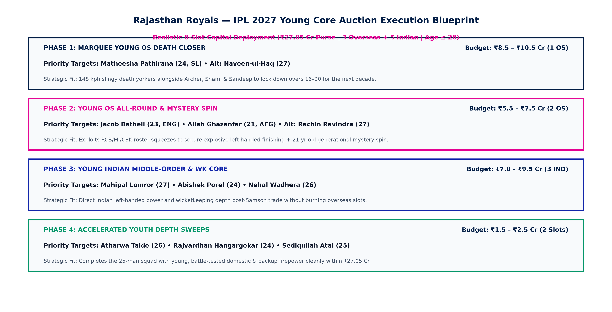

# Rajasthan Royals — IPL 2027 Young Core Auction & Scouting War Room
## SupeRR Selector Season 2: Identify the Most Reliable Young Players Under Pressure

[](https://github.com/umeshraj2007/SupeRR_S2)
[](https://github.com/umeshraj2007/SupeRR_S2)
[](https://github.com/umeshraj2007/SupeRR_S2)
[](https://umeshraj2007.github.io/SupeRR_S2/)

---

### Key Project Links
* **Live Interactive Dashboard:** [https://umeshraj2007.github.io/SupeRR_S2/](https://umeshraj2007.github.io/SupeRR_S2/)
* **Boardroom PDF Dossier (22 Pages):** [SupeRR_Selector_Season2_Report.pdf](SupeRR_Selector_Season2_Report.pdf)
* **Executed Jupyter Analysis Notebook:** [SupeRR_Selector_Season2_Analysis.ipynb](SupeRR_Selector_Season2_Analysis.ipynb)
* **Author:** Umeshraj Parkunan ([GitHub](https://github.com/umeshraj2007) • [LinkedIn](https://www.linkedin.com/in/umeshraj-parkunan/))

---

## Executive Summary & Official IPL 2027 Roster Context

In Season 1, Rajasthan Royals demonstrated the decisive competitive edge of empirical talent scouting by discovering **Vignesh Puthur**, whom RR signed at the 2026 auction. Entering Round 1 of **SupeRR Selector Season 2**, this dossier delivers a complete, boardroom-ready auction blueprint tailored for **Kumar Sangakkara** (Director of Cricket & Head Coach), **Giles Lindsay** (Head of Performance Analytics), and the RR War Room ahead of the IPL 2027 Auction in Goa.

Following the official BCCI retention deadline of **17 November 2026, 6:00 PM IST**, all 10 IPL franchises locked **180 retained/traded players**. Rather than restricting the analysis solely to uncapped domestic reserves or recommending aging 37+ veterans, this submission evaluates the **Young Open Auction Pool (`Age ≤ 28` in IPL 2027 — Capped, Overseas, and Uncapped)** across **200,999 raw IPL & Full-Member T20I deliveries (2022–2026)**, strictly excluding every officially retained player to surface **20 high-upside young specialists** (10 Batters, 10 Bowlers) built for a 5-year championship cycle.

<p align="center">
  
</p>

### 1. Rajasthan Royals' Official Squad & Leadership Status
* **Official Retained / Traded Core (17 Players):**
  1. Dhruv Jurel (Wicketkeeper-Finisher, Age 26)
  2. Riyan Parag (Middle-Order Anchor & Domestic Leadership Core, Age 25)
  3. Ravindra Jadeja (Veteran All-Phase All-Rounder)
  4. Sandeep Sharma (Death-Overs Closer)
  5. Jofra Archer (Express Strike Pacer — Overseas)
  6. Ravi Bishnoi (Lead Wrist-Spinner, Age 26)
  7. Mohammed Shami (Frontline Pace Spearhead — Traded In from LSG)
  8. Manimaran Siddharth (Left-Arm Spinner — Traded In from LSG)
  9. Nandre Burger (Left-Arm Express Seamer — Overseas)
  10. Vaibhav Suryavanshi (Top-Order Prodigy, Age 16)
  11. Shubham Dubey (Middle-Order Hitter)
  12. Donovan Ferreira (Power Finisher / Keeper — Overseas)
  13. Lhuan-dre Pretorius (Top-Order Batter / Keeper — Overseas)
  14. Sushant Mishra (Left-Arm Seamer)
  15. Aman Rao (Domestic Batter)
  16. Yash Raj Punja (Fast Bowler)
  17. Brijesh Sharma (Domestic All-Rounder)

* **Major Pre-Auction Trades Executed:**
  * **Sanju Samson Traded to Chennai Super Kings (CSK):** Sanju Samson completed a pre-season trade to CSK, ending his tenure as Rajasthan Royals captain. RR's on-field domestic core is led by **Riyan Parag** and **Dhruv Jurel** under **Kumar Sangakkara** and **Giles Lindsay**.
  * **Sam Curran Traded to Lucknow Super Giants (LSG):** Freed key salary cap flexibility.
  * **Mohammed Shami & Manimaran Siddharth Acquired from LSG:** Anchors RR's frontline seam and finger-spin attack.

* **Auction Capital & Constraints:**
  * **Remaining Purse:** **₹27.05 Crore**
  * **Open Roster Slots:** **8 Slots Total (3 Overseas + 5 Indian)**

---

## Analytical Methodology: Isolating Clutch Young Talent

Standard aggregate averages fail in IPL auctions because they weight garbage-time overs identically to high-stakes crunch situations and treat stale 2022 form identically to 2025–2026 execution. Our empirical model evaluates all **200,999 deliveries (`371` IPL + `512` T20I matches)** across four pillars:

$$\text{Weight}(t) = e^{-\lambda \cdot (2026 - \text{Year})}, \quad \lambda = 0.28$$

1. **High-Pressure Context Isolation:** Death overs (`16–20`), steep run chases (`RRR >= 10.5`), top-order collapses (`<= 30/3` inside Powerplay), tight defenses, and knockout fixtures.
2. **Dynamic Phase-Par Benchmarking:** Computes **Batting Strike Rate Edge vs Par** (`Pressure SR - Expected Par SR`) and **Bowling Runs Saved/Over vs Par** (`Expected Par Econ - Pressure Econ`) specific to format, season, and phase.
3. **Exponential Recency Decay + Empirical Bayesian Shrinkage:** Weights recent 2024–2026 performance highest while regressing small samples toward replacement-level priors to eliminate single-match flukes.
4. **Young Core Filter (`Age ≤ 28` in IPL 2027) + Retention Exclusion:** Strictly removes all **180 officially retained IPL 2027 players** and aging veterans (37+), isolating long-term championship assets.

---

## 4-Quadrant Pressure Impact Matrix (Young Open Pool)

<p align="center">
  
</p>

---

## Dual Benchmark Performance Under High Pressure

<p align="center">
  
</p>

---

## Top 10 Young Available Batters Under Pressure *(Age ≤ 28 in IPL 2027)*

| Rank | Player | Age (2027) | Status | Tactical Role | Pressure Balls | Pressure SR | SR Edge | Cons % | Est. Valuation |
| :---: | :--- | :---: | :---: | :--- | :---: | :---: | :---: | :---: | :---: |
| **1** | **Harry Brook** | 28 | OS (ENG) | Explosive Middle-Order Finisher | 332 | **151.2** | **+13.9** | 50% | ₹4.0 – ₹7.0 Cr |
| **2** | **Rachin Ravindra** | 27 | OS (NZ) | Left-Hand Top-Order & SLA | 195 | **154.4** | **+10.1** | 67% | ₹3.0 – ₹5.0 Cr |
| **3** | **Jacob Bethell** | 23 | OS (ENG) | Dynamic LH Finisher & SLA | 142 | **149.3** | **+12.5** | 45% | ₹2.0 – ₹4.0 Cr |
| **4** | **Sediqullah Atal** | 25 | OS (AFG) | Aggressive LH Power Opener | 107 | **130.8** | -5.8 | 33% | ₹0.75 – ₹1.5 Cr |
| **5** | **Mitchell Owen** | 25 | OS (AUS) | Power Hitter & Seam All-Rounder | 70 | **120.0** | -13.3 | 20% | ₹1.0 – ₹2.5 Cr |
| **6** | **Mahipal Lomror** | 27 | **IND Uncapped** | Middle-Order Spin Destroyer | 144 | **163.9** | **+16.8** | **82%** | ₹2.0 – ₹3.5 Cr |
| **7** | **Pathum Nissanka** | 28 | OS (SL) | Composed Top-Order Chase Anchor | 267 | **147.6** | **+8.3** | 57% | ₹1.0 – ₹2.0 Cr |
| **8** | **Yashasvi Jaiswal** | 25 | **IND Capped** | Franchise Powerplay Opener | 267 | **170.0** | **+19.4** | 62% | ₹14.0 – ₹18.0 Cr |
| **9** | **Abishek Porel** | 24 | **IND Uncapped** | Dynamic LH Wicketkeeper-Batter | 162 | **132.1** | -19.9 | 44% | ₹2.5 – ₹4.0 Cr |
| **10** | **Nehal Wadhera** | 26 | **IND Uncapped** | Middle-Order Power Finisher | 366 | **141.0** | -10.4 | 40% | ₹2.0 – ₹3.5 Cr |

---

## Top 10 Young Available Bowlers Under Pressure *(Age ≤ 28 in IPL 2027)*

| Rank | Player | Age (2027) | Status | Tactical Role | Pressure Balls | Pressure Econ | Saved/Ov | Cons % | Est. Valuation |
| :---: | :--- | :---: | :---: | :--- | :---: | :---: | :---: | :---: | :---: |
| **1** | **Matheesha Pathirana** | 24 | OS (SL) | 148 kph Slingy Death Closer | 653 | **8.74** | **+0.23** | **76%** | ₹8.0 – ₹11.0 Cr |
| **2** | **Mujeeb Ur Rahman** | 26 | OS (AFG) | Powerplay & Middle Mystery Spin | 249 | **6.80** | **+1.68** | **89%** | ₹1.5 – ₹2.5 Cr |
| **3** | **Naveen-ul-Haq** | 27 | OS (AFG) | Death-Overs Slower-Ball Pacer | 373 | **8.65** | **+0.22** | 63% | ₹2.0 – ₹3.5 Cr |
| **4** | **Maheesh Theekshana** | 26 | OS (SL) | All-Phase Carrom-Ball Spinner | 812 | **7.74** | **+0.96** | 69% | ₹2.5 – ₹4.0 Cr |
| **5** | **Gerald Coetzee** | 26 | OS (SA) | 150 kph Enforcer Strike Pacer | 230 | **9.16** | -0.07 | 57% | ₹2.5 – ₹4.5 Cr |
| **6** | **Fazalhaq Farooqi** | 26 | OS (AFG) | Left-Arm Swing & Death Yorker | 339 | **8.92** | -0.36 | 52% | ₹1.5 – ₹2.5 Cr |
| **7** | **Shamar Joseph** | 27 | OS (WI) | 150 kph Raw Express Pacer | 215 | **9.49** | -0.97 | 47% | ₹1.0 – ₹2.0 Cr |
| **8** | **Joshua Little** | 27 | OS (IRE) | Left-Arm Powerplay & Death Seam | 323 | **8.28** | **+0.35** | 55% | ₹1.0 – ₹2.0 Cr |
| **9** | **Allah Ghazanfar** | 21 | OS (AFG) | 21-Yr-Old Mystery Spinner | 102 | **9.88** | -0.59 | 33% | ₹2.5 – ₹4.5 Cr |
| **10** | **Will O'Rourke** | 25 | OS (NZ) | Tall 145+ kph Hit-The-Deck Seam | 105 | **9.37** | -0.62 | 57% | ₹1.5 – ₹3.0 Cr |

---

## Franchise Roster Squeeze & RR's Realistic 8-Slot Execution Blueprint

<p align="center">
  
</p>

<p align="center">
  
</p>

With **₹27.05 Crore** and **8 open roster slots (3 Overseas + 5 Indian)** against heavily squeezed rivals (GT 23 retained, RCB 21, CSK 19, PBKS 19), Rajasthan Royals can realistically acquire an entire 5-year championship youth core:

* **3 Young Overseas Acquisitions (~₹14.5 – ₹17.5 Cr):**
  1. **Matheesha Pathirana (Age 24)** *(₹8.5–10.5 Cr)* — Pairs with Archer, Shami & Sandeep to dominate overs 16–20.
  2. **Jacob Bethell (Age 23)** *(₹2.5–4.0 Cr)* **or Rachin Ravindra (Age 27)** *(₹3.5–4.5 Cr)* — Left-handed middle/top-order power + SLA spin.
  3. **Allah Ghazanfar (Age 21)** *(₹2.5–3.5 Cr)* **or Naveen-ul-Haq (Age 27)** *(₹2.0–3.0 Cr)* — Mystery spin X-factor or death-pace backup.
* **5 Young Indian Acquisitions (~₹9.5 – ₹12.5 Cr):**
  1. **Mahipal Lomror (Age 27)** *(₹2.5–3.5 Cr)* — Home-state Rajasthan left-handed spin destroyer (`163.9 P-SR`, `82% Cons`).
  2. **Abishek Porel (Age 24)** *(₹2.5–3.5 Cr)* — Dynamic Indian wicketkeeper-batter depth behind Dhruv Jurel.
  3. **Nehal Wadhera (Age 26)** *(₹2.0–3.0 Cr)* — Left-handed middle-order finisher.
  4. **Atharwa Taide (Age 26)** & **Rajvardhan Hangargekar (Age 24)** *(₹1.5–2.5 Cr combined)* — Value domestic top-order & 142+ kph seam all-rounder depth.
  *(Alternate Marquee Pivot: If RR allocates ₹15–17 Cr to re-sign **Yashasvi Jaiswal [Age 25]**, pivot overseas slots to value stars **Naveen-ul-Haq + Jacob Bethell + Mujeeb Ur Rahman**.)*

---

## Repository Structure

```
SupeRR/
├── index.html                                  # Live interactive War Room dashboard (Single Webpage)
├── SupeRR_Selector_Season2_Report.pdf          # 22-page boardroom executive dossier (PDF)
├── SupeRR_Selector_Season2_Analysis.ipynb      # Executed reproducible Python analysis notebook
├── report_template_22pages.html                # High-fidelity 22-page HTML template for PDF
├── evaluated_targets_2027.json                 # Complete stats & narratives for all 20 young targets
├── actual_retained_names.json                  # Official 180 retained IPL 2027 players (Nov 17 cutoff)
├── data/                                       # Official competition datasets (IPL + T20I, 2022–2026)
├── images/                                     # 20 authentic dark cosmic cards + 5 300-DPI infographics
└── old/                                        # Historical archive of preliminary pre-retention drafts
```
