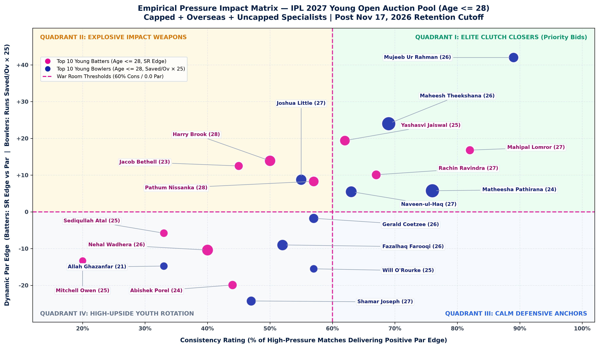
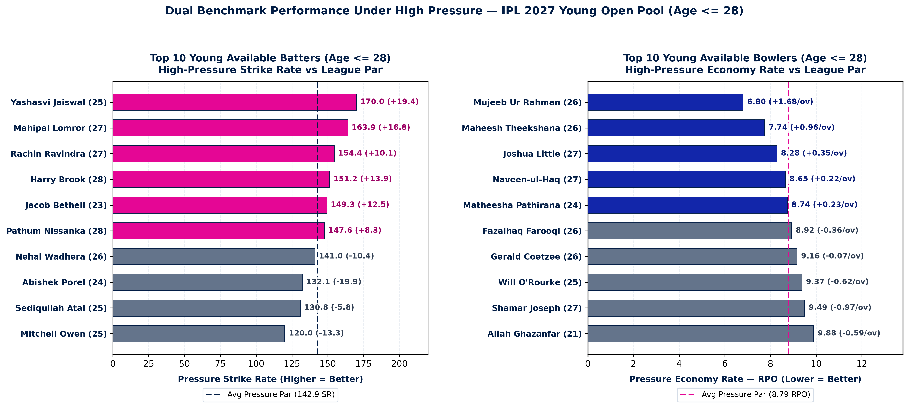

# Rajasthan Royals — IPL 2027 Auction & Scouting Intelligence War Room
## SupeRR Selector Season 2: Young Open Pool High-Pressure Specialists (Age ≤ 28)

[](https://github.com/umeshraj2007/SupeRR_S2)
[-E50695?style=for-the-badge&logo=target&logoColor=white)](https://github.com/umeshraj2007/SupeRR_S2)
[](https://github.com/umeshraj2007/SupeRR_S2)
[](https://umeshraj2007.github.io/SupeRR_S2/)

---

### Key Project Deliverables
* **Live Interactive Dashboard:** [https://umeshraj2007.github.io/SupeRR_S2/](https://umeshraj2007.github.io/SupeRR_S2/)
* **Boardroom PDF Dossier (22 Pages):** [SupeRR_Selector_Season2_Report.pdf](SupeRR_Selector_Season2_Report.pdf)
* **Executed Jupyter Analysis Notebook:** [SupeRR_Selector_Season2_Analysis.ipynb](SupeRR_Selector_Season2_Analysis.ipynb)
* **Author:** Umeshraj Parkunan ([GitHub](https://github.com/umeshraj2007) • [LinkedIn](https://www.linkedin.com/in/umeshraj-parkunan/))

---

## Executive Summary & Official IPL 2027 Roster Context

In Season 1, Rajasthan Royals demonstrated the value of empirical talent scouting by discovering **Vignesh Puthur**, whom RR signed at the 2026 auction. For Round 1 of **SupeRR Selector Season 2**, this boardroom dossier is prepared for **Kumar Sangakkara** (Director of Cricket & Head Coach) and **Giles Lindsay** (Head of Performance Analytics) ahead of the IPL 2027 Mega-Auction in Goa.

Following the official BCCI retention deadline of **17 November 2026, 6:00 PM IST**, all 10 IPL franchises locked 180 retained/traded players. Rather than restricting the search to a single narrow pool, this submission evaluates the **full open auction pool (Capped + Overseas + Uncapped)** across **200,999 raw IPL & T20I deliveries (883 matches, 2022–2026)**, strictly applying three front-office filters:
1. **Zero Officially Retained Overlap:** Excludes all 180 players locked on November 17, 2026.
2. **Youth Core Filter (`Age ≤ 28` in IPL 2027):** Eliminates aging veterans (average shortlisted age: **25.6 years**) to build a multi-cycle championship core alongside Riyan Parag (25), Dhruv Jurel (26), and Vaibhav Suryavanshi (16).
3. **High-Leverage Reliability:** Ranks players strictly by **Empirical Bayesian Pressure Score**, combining **Dynamic Phase-Par Edge**, **Multi-Match Consistency %**, and **Exponential Recency Weighting ($\lambda = 0.28$)**.

<p align="center">
  
</p>

### 1. Rajasthan Royals' Official Squad & Leadership Status
* **Official Retained / Traded Core (17 Players):**
  Dhruv Jurel, Riyan Parag, Ravindra Jadeja, Sandeep Sharma, Jofra Archer, Ravi Bishnoi, Mohammed Shami *(Traded In from LSG)*, Manimaran Siddharth *(Traded In from LSG)*, Nandre Burger, Vaibhav Suryavanshi, Shubham Dubey, Donovan Ferreira, Lhuan-dre Pretorius, Sushant Mishra, Aman Rao, Yash Raj Punja, Brijesh Sharma.
* **Major Pre-Auction Trades Executed:**
  * **Sanju Samson Traded to Chennai Super Kings (CSK):** Concluded his tenure as RR captain. On-field domestic leadership now centers on **Riyan Parag** and **Dhruv Jurel**, guided by **Kumar Sangakkara** and **Giles Lindsay**.
  * **Sam Curran Traded to Lucknow Super Giants (LSG).**
  * **Mohammed Shami & Manimaran Siddharth Acquired from LSG.**
* **Auction Capital Status:** **₹27.05 Crore** available across **8 open roster slots (3 Overseas + 5 Indian)**.

---

## Analytical Methodology: Isolating Clutch Reliability

Standard aggregate averages treat low-leverage overs identically to match-deciding crunch phases. Our model evaluates every delivery across **371 IPL matches** and **512 T20I matches (2022–2026)**:

$$\text{Weight}(t) = e^{-\lambda \cdot (2026 - \text{Year})}, \quad \lambda = 0.28$$

* **High-Pressure Context Isolation:** Death overs (`16–20`), steep chases (`RRR >= 10.0`), top-order collapses (`<= 30/3` inside Powerplay), and tight defenses (`< 45` to defend in the last 4 overs).
* **Dynamic Par Edge:**
  * *Batters:* `Pressure Strike Rate − Expected Phase Par SR`
  * *Bowlers:* `Expected Phase Par Economy − Pressure Economy`
* **Bayesian Shrinkage & Consistency %:** Stabilizes small samples toward replacement-level priors while prioritizing positive win-equity rate per high-leverage delivery over raw low-pressure match volume.

---

## 4-Quadrant Pressure Impact Matrix (Young Open Pool, Age ≤ 28)

<p align="center">
  
</p>

* **Quadrant I (Elite Clutch Closers — Priority Bids, ≥ 60% Cons & Positive Par Edge):**
  * **7 Young Stars:** **Mujeeb Ur Rahman (26)**, **Mahipal Lomror (27)**, **Matheesha Pathirana (24)**, **Maheesh Theekshana (26)**, **Rachin Ravindra (27)**, **Naveen-ul-Haq (27)**, and **Yashasvi Jaiswal (25)**.
* **Quadrant II (Explosive Impact Weapons):**
  * **Harry Brook (28)**, **Jacob Bethell (23)**, **Joshua Little (27)**, and **Pathum Nissanka (28)**.
* **Quadrant IV (High-Upside Youth Rotation):**
  * **Gerald Coetzee (26)**, **Fazalhaq Farooqi (26)**, **Will O'Rourke (25)**, **Shamar Joseph (27)**, **Allah Ghazanfar (21)**, **Nehal Wadhera (26)**, **Abishek Porel (24)**, **Sediqullah Atal (25)**, and **Mitchell Owen (25)**.

---

## Dual Benchmark Performance Under High Pressure

<p align="center">
  
</p>

---

## Top 10 Young Available Batters (Age ≤ 28 | Ranked by Pressure Score)

| Rank | Player | Age (2027) | Country / Status | Last IPL Setup | P-Balls | Pressure SR | SR Edge | Cons % | P-Score | Est. Valuation |
| :---: | :--- | :---: | :--- | :--- | :---: | :---: | :---: | :---: | :---: | :---: |
| **1** | **Mahipal Lomror** | 27 | India (Uncapped) | Mumbai Indians | 144 | **163.9** | **+16.8** | **82%** | **+9.2** | ₹2.00 – ₹3.50 Cr |
| **2** | **Yashasvi Jaiswal** | 25 | India (Capped) | Rajasthan Royals | 267 | **170.0** | **+19.4** | **62%** | **+9.1** | ₹14.0 – ₹18.0 Cr |
| **3** | **Rachin Ravindra** | 27 | New Zealand (OS) | Kolkata Knight Riders | 195 | **154.4** | **+10.1** | **67%** | **+5.9** | ₹3.00 – ₹5.00 Cr |
| **4** | **Pathum Nissanka** | 28 | Sri Lanka (OS) | Delhi Capitals | 267 | **147.6** | **+8.3** | **57%** | **+4.5** | ₹1.00 – ₹2.00 Cr |
| **5** | **Harry Brook** | 28 | England (OS) | Delhi Capitals | 332 | **151.2** | **+13.9** | **50%** | **+3.0** | ₹4.00 – ₹7.00 Cr |
| **6** | **Jacob Bethell** | 23 | England (OS) | Royal Challengers Bengaluru | 142 | **149.3** | **+12.5** | **45%** | **+2.3** | ₹2.00 – ₹4.00 Cr |
| **7** | **Sediqullah Atal** | 25 | Afghanistan (OS) | Delhi Capitals | 107 | **130.8** | -5.8 | 33% | -3.9 | ₹0.75 – ₹1.50 Cr |
| **8** | **Nehal Wadhera** | 26 | India (Uncapped) | Punjab Kings | 366 | **141.0** | -10.4 | 40% | -6.9 | ₹2.00 – ₹3.50 Cr |
| **9** | **Abishek Porel** | 24 | India (Uncapped) | Delhi Capitals | 162 | **132.1** | -19.9 | 44% | -8.7 | ₹2.50 – ₹4.00 Cr |
| **10** | **Mitchell Owen** | 25 | Australia (OS) | Punjab Kings | 70 | **120.0** | -13.3 | 20% | -9.3 | ₹1.00 – ₹2.50 Cr |

---

## Top 10 Young Available Bowlers (Age ≤ 28 | Ranked by Pressure Score)

| Rank | Player | Age (2027) | Country / Status | Last IPL Setup | P-Balls | P-Econ | Saved/Ov | Wkts/4ov | Cons % | P-Score | Est. Valuation |
| :---: | :--- | :---: | :--- | :--- | :---: | :---: | :---: | :---: | :---: | :---: | :---: |
| **1** | **Mujeeb Ur Rahman** | 26 | Afghanistan (OS) | Mumbai Indians | 249 | **6.80** | **+1.68** | 1.16 | **89%** | **+9.3** | ₹1.50 – ₹2.50 Cr |
| **2** | **Matheesha Pathirana** | 24 | Sri Lanka (OS) | Kolkata Knight Riders | 653 | **8.74** | **+0.23** | **1.95** | **76%** | **+6.9** | ₹8.00 – ₹11.0 Cr |
| **3** | **Maheesh Theekshana** | 26 | Sri Lanka (OS) | Rajasthan Royals | 812 | **7.74** | **+0.96** | 1.03 | **69%** | **+4.3** | ₹2.50 – ₹4.00 Cr |
| **4** | **Naveen-ul-Haq** | 27 | Afghanistan (OS) | Lucknow Super Giants | 373 | **8.65** | **+0.22** | 1.48 | **63%** | **+2.8** | ₹2.00 – ₹3.50 Cr |
| **5** | **Joshua Little** | 27 | Ireland (OS) | Gujarat Titans | 323 | **8.28** | **+0.35** | 1.34 | **55%** | **+1.4** | ₹1.00 – ₹2.00 Cr |
| **6** | **Gerald Coetzee** | 26 | South Africa (OS) | Sunrisers Hyderabad | 230 | **9.16** | -0.07 | 1.67 | **57%** | **+0.6** | ₹2.50 – ₹4.50 Cr |
| **7** | **Will O'Rourke** | 25 | New Zealand (OS) | Lucknow Super Giants | 105 | **9.37** | -0.62 | 1.83 | **57%** | **+0.3** | ₹1.50 – ₹3.00 Cr |
| **8** | **Shamar Joseph** | 27 | West Indies (OS) | Lucknow Super Giants | 215 | **9.49** | -0.97 | 1.79 | 47% | -1.3 | ₹1.00 – ₹2.00 Cr |
| **9** | **Fazalhaq Farooqi** | 26 | Afghanistan (OS) | Rajasthan Royals | 339 | **8.92** | -0.36 | 1.13 | 52% | -1.9 | ₹1.50 – ₹2.50 Cr |
| **10** | **Allah Ghazanfar** | 21 | Afghanistan (OS) | Mumbai Indians | 102 | **9.88** | -0.59 | 1.18 | 33% | -4.3 | ₹2.50 – ₹4.50 Cr |

---

## Franchise Roster Squeeze & Realistic 8-Slot RR Acquisition Plan (₹27.05 Cr)

<p align="center">
  
</p>

<p align="center">
  
</p>

Because rival franchises enter the auction with tight slot caps (GT 23 retained, RCB 21, CSK 19, PBKS 19), Rajasthan Royals can realistically land **all 8 open slots (3 Overseas + 5 Indian)** within **₹27.05 Cr**:

* **3 Young Overseas Acquisitions (~₹14.0 – ₹17.5 Cr):**
  1. **Matheesha Pathirana (Age 24)** *(₹8.5–10.5 Cr)* — Pairs with Archer, Shami, and Sandeep Sharma to lock down death overs 16–20. *(Budget backup: Naveen-ul-Haq at ₹2.5 Cr).*
  2. **Jacob Bethell (Age 23)** *(₹2.5–4.0 Cr)* **or Rachin Ravindra (Age 27)** *(₹3.5–4.5 Cr)* — Left-handed top/middle-order hitter + SLA spin overs.
  3. **Mujeeb Ur Rahman (Age 26)** *(₹1.5–2.5 Cr)* **or Allah Ghazanfar (Age 21)** *(₹2.5–3.5 Cr)* — Powerplay & middle-overs mystery spin partnering Ravi Bishnoi.
* **5 Young Indian Acquisitions (~₹9.5 – ₹12.5 Cr):**
  1. **Mahipal Lomror (Age 27)** *(₹2.0–3.5 Cr)* — Local Rajasthan left-hand spin destroyer post-Samson trade.
  2. **Abishek Porel (Age 24)** *(₹2.5–3.5 Cr)* — Dynamic Indian wicketkeeper-batter alongside Dhruv Jurel.
  3. **Nehal Wadhera (Age 26)** *(₹2.0–3.0 Cr)* — Left-handed Indian middle-order power finisher.
  4. **Contingency Marquee Pivot — Yashasvi Jaiswal (Age 25):** If Jaiswal enters the open auction, allocate ₹14–16 Cr to bring him home and fill the 3 OS slots with high-value young steals (**Mujeeb**, **Naveen-ul-Haq**, **Jacob Bethell**).
  5. **Domestic Base-Price Depth:** Add young domestic backups at base price to complete the 25-man roster under cap.

---

## Repository Structure

```
SupeRR/
├── index.html                                  # Live interactive War Room dashboard (Single Webpage)
├── SupeRR_Selector_Season2_Report.pdf          # 22-page boardroom executive dossier (PDF)
├── SupeRR_Selector_Season2_Analysis.ipynb      # Executed Python & Matplotlib analysis notebook
├── report_template_22pages.html                # High-fidelity HTML template for 22-page PDF
├── evaluated_targets_2027.json                 # Complete stats, narratives & youth database (20 targets)
├── actual_retained_names.json                  # Official 180 retained players across 10 franchises
├── data/                                       # Official competition datasets (883 IPL + T20I matches)
├── images/                                     # 20 authentic dark cosmic cards + 5 300-DPI infographics
└── old/                                        # Historical archive of earlier drafts
```
