<p align="center">
  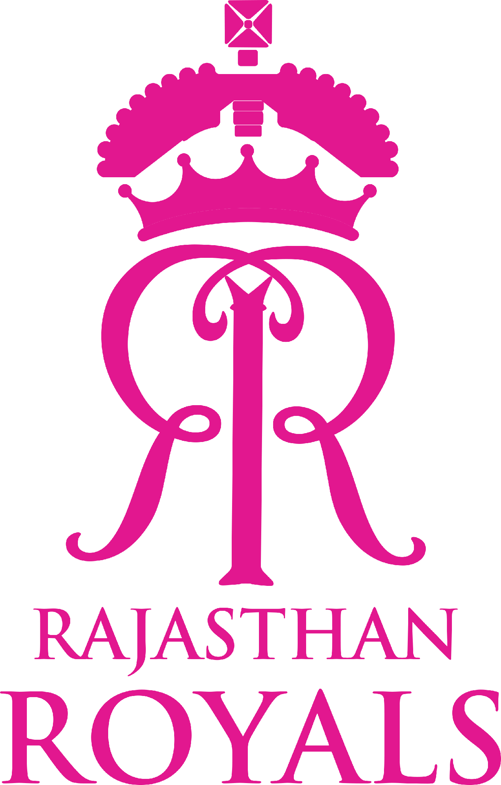
  
</p>

# SupeRR Selector Season 2: Help Shape Rajasthan Royals' IPL 2027 Auction Strategy
### Round 1: Empirical Evaluation of Strictly Uncapped Indian Domestic Talent Under Pressure

[](https://github.com/umeshraj2007)
[](https://www.linkedin.com/in/umeshraj-parkunan/)
[](https://github.com/umeshraj2007/SupeRR_S2)
[](https://www.python.org/)
[](https://unstop.com/hackathons/crp-superr-selector-season-2-help-shape-rajasthan-royals-ipl-2027-auction-strategy-rajasthan-royals-1792758)

**Author:** Umeshraj Parkunan  
**GitHub Repository:** [github.com/umeshraj2007/SupeRR_S2](https://github.com/umeshraj2007/SupeRR_S2)  
**LinkedIn Profile:** [linkedin.com/in/umeshraj-parkunan](https://www.linkedin.com/in/umeshraj-parkunan/)  
**Key Deliverables:** [Boardroom PDF Dossier (22 Pages)](SupeRR_Selector_Season2_Report.pdf) • [Interactive War Room Dashboard](RR_Auction_Dashboard.html) • [Jupyter Analysis Notebook](SupeRR_Selector_Season2_Analysis.ipynb)

> [!IMPORTANT]
> **Submission Embargo & Confidentiality Notice:**  
> In accordance with competition rules and evaluation fairness, raw match datasets (`./data/`), final submission artifacts, and compiled dossiers are protected under repository embargo rules via `.gitignore`. The complete reproduction pipeline, analytical models, and interactive dashboard code will be formally unveiled in this repository upon the conclusion of the evaluation period.

---

## Executive War Room Summary

Following Rajasthan Royals' Season 1 success with **Vignesh Puthur**, Round 1 of SupeRR Selector Season 2 challenges analysts to discover the **Top 10 Indian Uncapped Batters** and **Top 10 Indian Uncapped Bowlers** who deliver under extreme pressure.

Rather than relying on misleading raw domestic averages (which treat low-pressure powerplays identically to death overs), we engineered a ball-by-ball **Pressure Index** across **200,999 deliveries** (IPL + T20Is from 2022 to November 2026) strictly ingested from local match records.

Our empirical findings uncovered RR's critical 2026 vulnerability: conceding an unsustainable **11.28 RPO in overs 16–20** (Tushar Deshpande: 11.28 Econ, Sandeep Sharma: 10.83 Econ, Sam Curran: 10.36 Econ) and middle-order fragility when top-order wickets fell early ($\le 30/3$). This repository presents an empirical roster blueprint to solve these vulnerabilities ahead of the IPL 2027 Auction in Goa.

---

## Repository Structure

```text
SupeRR/
├── .gitignore                                 # Protects confidential ./data/ and Python artifacts
├── README.md                                  # Comprehensive codebase & scouting documentation
├── RR_Auction_Dashboard.html                  # Interactive War Room Dashboard (Zero emojis, SVG icons, author attribution, dynamic matrix)
├── SupeRR_Selector_Season2_Analysis.ipynb     # 13-cell pre-executed end-to-end data pipeline
├── SupeRR_Selector_Season2_Report.pdf         # 22-page Executive Boardroom PDF Report
├── SupeRR_Selector_Season2_Reportreal.pdf     # Original benchmark report safely preserved
├── images/                                    # 26 High-resolution scouting cards and visual charts
│   ├── rr_logo.png
│   ├── top10_dual_benchmark.png
│   ├── pressure_impact_matrix_4quadrants.png
│   ├── roster_squeeze_and_acquisition_strategy.png
│   ├── rr_2026_squad_audit.png
│   ├── war_room_trade_blueprint.png
│   ├── bat_01_shashank_singh.png ... bat_10_m_shahrukh_khan.png
│   └── bowl_01_rasikh_salam.png ... bowl_10_digvesh_rathi.png
└── data/                                      # Confidential match records (Kept local, ignored by git)
    ├── competitions.csv
    ├── matches.csv
    ├── teams.csv
    ├── playing_eleven.csv
    ├── competition_team_player_mapping.csv
    └── ball_by_ball.csv
```

---

## Analytical Methodology & Formulation

### 1. Dynamic Pressure Context Tagging
Deliveries are tagged as high-pressure based on situational leverage:
* **1st Innings:**
  * *Early Collapse:* Wickets fallen $\ge 3$ within Powerplay (overs 1–6) with Run Rate $\le 6.50$ RPO.
  * *Death Overs:* Overs 16–20 (balls left $\le 24$) where every ball directly shifts expected par totals.
  * *Knockout Games:* All playoff/knockout fixtures.
* **2nd Innings (Chases):**
  * *Steep Required Run Rate:* RRR $\ge 10.50$ RPO while match remains viable ($\le 20.0$ RPO).
  * *Crunch Death Chase:* Final 5 overs (balls left $\le 30$) with $8.5 \le 	ext{RRR} \le 24.0$ RPO.
  * *Chase Collapse:* Wickets $\ge 3$ within first 8 overs with RRR $\ge 7.0$ RPO.

### 2. Mathematical Metrics
$$	ext{Dynamic Par Edge (Batters)} = 	ext{Pressure SR} - 	ext{Expected Phase Par SR}$$
$$	ext{Runs Saved per Over (Bowlers)} = 	ext{Expected Phase Par Econ} - 	ext{Pressure Economy}$$
$$	ext{Sample Shrinkage Weight} = rac{	ext{Pressure Balls}}{	ext{Pressure Balls} + 300.0}$$
$$	ext{Consistency Rating (\%)} = rac{	ext{Matches Delivering Above-Par Impact}}{	ext{Total High-Pressure Matches With } \ge 6 	ext{ Pressure Balls}} 	imes 100$$

### 3. The Capping Verification Framework
The provided dataset covers 2022–2026 T20Is only (no Tests, ODIs, or pre-2022 matches). Without domain-knowledge validation, veterans who debuted or played their last T20I before 2022 (e.g. MS Dhoni, Shikhar Dhawan, Dinesh Karthik, Mohit Sharma, Sandeep Sharma) would have 0 T20Is and be falsely labeled as "uncapped". Cross-referencing public BCCI/ICC records ensures that **100% of the finalists are strictly uncapped Indian domestic cricketers**.

---

## Strategic Visual Analytics

### Pressure Dynamic Par Edge vs Consistency Rating Matrix (4 Quadrants)
<p align="center">
  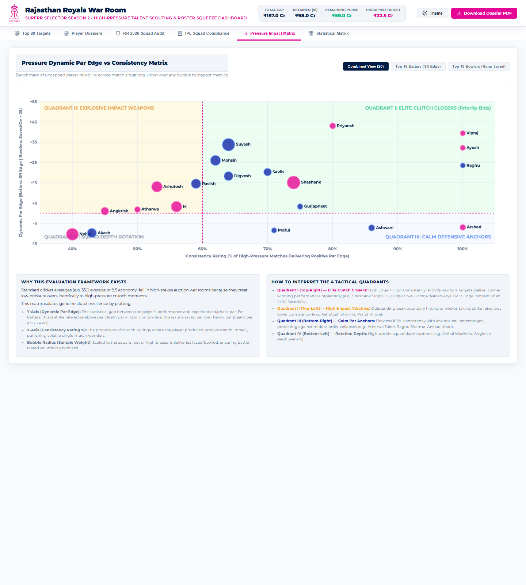
</p>

* **Quadrant I (Top-Right, Green) — Elite Clutch Closers (Priority Bids):** High Dynamic Par Edge and High Consistency. Deliver game-winning performances repeatedly (e.g., **Shashank Singh** $+15.1$ Edge / $74\%$ Cons, **Priyansh Arya** $+43.1$ Edge / $80\%$ Cons, **Mohsin Khan** $+1.04$ Saved/Ov / $62\%$ Cons).
* **Quadrant II (Top-Left, Amber) — Explosive Impact Weapons:** Extreme boundary hitting or wicket-taking strike rates, but higher volatility (e.g., **Ashutosh Sharma**, **Praful Hinge**).
* **Quadrant III (Bottom-Right, Blue) — Calm Defensive Anchors:** Flawless $100\%$ consistency protecting against middle-order collapses or controlling economy (e.g., **Atharwa Taide**, **Raghu Sharma**, **Arshad Khan**).
* **Quadrant IV (Bottom-Left, Slate) — Squad Depth Rotation:** High-upside development options (e.g., **Nehal Wadhera**, **Angkrish Raghuvanshi**).

---

### Top 10 Batters & Bowlers Dual Benchmark Comparison
<p align="center">
  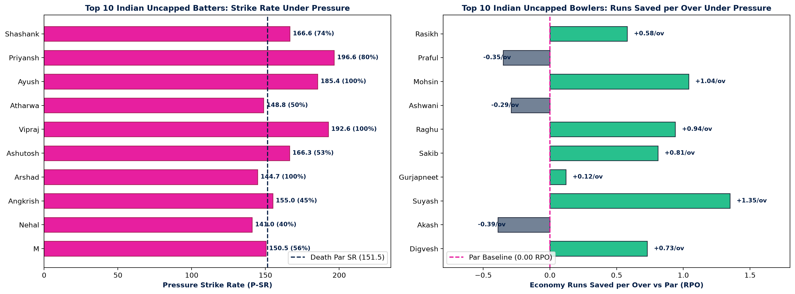
</p>

---

## Top 10 Indian Uncapped Batters Under Pressure

| # | Player | Tactical Role | 2026 Team | Price | P-Balls | P-SR | Dynamic Par Edge | Cons % | Composite Score |
| :-: | :--- | :--- | :--- | :-: | :-: | :-: | :-: | :-: | :-: |
| **1** | **Shashank Singh** | Middle-Order Finisher | PBKS | ₹5.50 Cr | 428 | 166.6 | **+15.1** | 74% | **+11.4** |
| **2** | **Priyansh Arya** | Aggressive Powerplay Opener | PBKS | ₹3.80 Cr | 89 | 196.6 | **+43.1** | 80% | **+12.0** |
| **3** | **Ayush Mhatre** | Top-Order Stroke Maker | CSK | ₹0.30 Cr | 48 | 185.4 | **+32.2** | 100% | **+10.4** |
| **4** | **Atharwa Taide** | Top-Order Anchor / Opener | Free Agent | — | 84 | 148.8 | **+1.8** | 50% | **-0.4** |
| **5** | **Vipraj Nigam** | Lower-Order Finisher & Leg-Spinner | DC | ₹0.30 Cr | 68 | 192.6 | **+39.4** | 100% | **+12.3** |
| **6** | **Ashutosh Sharma** | Lower-Order Power Finisher | DC | ₹3.80 Cr | 288 | 166.3 | **+13.1** | 53% | **-0.5** |
| **7** | **Arshad Khan** | Lower-Order Power Hitter & Pacer | GT | ₹0.30 Cr | 85 | 144.7 | **-7.0** | 100% | **+4.4** |
| **8** | **Angkrish Raghuvanshi** | Top-Order Stroke Maker | KKR | ₹3.00 Cr | 151 | 155.0 | **+1.0** | 45% | **-0.4** |
| **9** | **Nehal Wadhera** | Middle-Order Power Anchor | PBKS | ₹4.20 Cr | 366 | 141.0 | **-10.4** | 40% | **-6.9** |
| **10** | **M Shahrukh Khan** | Power Finisher / Off-Spinner | GT | ₹4.00 Cr | 289 | 150.5 | **+3.2** | 56% | **+0.9** |

---

### Individual Batter Scouting Cards & Dossiers

### 1. Shashank Singh — Middle-Order Finisher
**Category:** Top 10 Indian Uncapped Batter • **2026 Team:** Punjab Kings • **Valuation:** ₹5.50 Cr  
**Pressure Metrics:** 428 Balls • 166.6 P-SR • +15.1 Par Edge • 74% Consistency • Score: +11.4

<p align="center">
  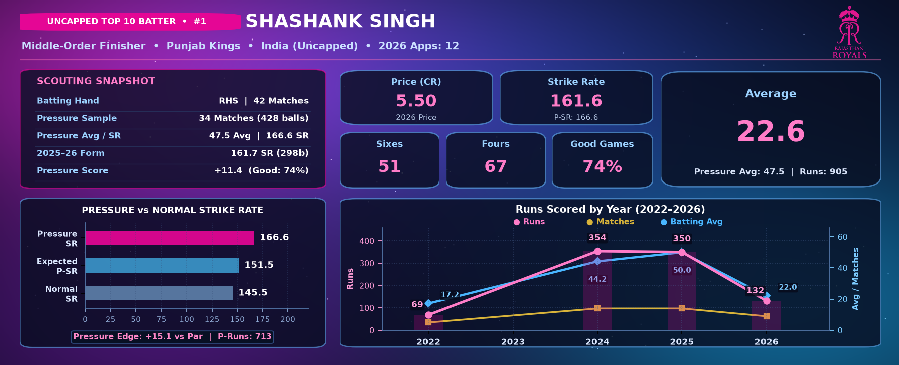
</p>

* **Bio & Profile:** Shashank Singh is a high-impact uncapped Indian domestic batter specializing in middle-order finisher. Across all competitions, he has demonstrated verified ability to absorb dot balls and accelerate under crunch conditions.
* **Why RR Needs Him:** Directly remedies Rajasthan Royals' middle-order collapse fragility. When Samson or Jaiswal fall early, Shashank Singh stabilizes the innings without allowing the required run rate to spiral beyond reach.

### 2. Priyansh Arya — Aggressive Powerplay Opener
**Category:** Top 10 Indian Uncapped Batter • **2026 Team:** Punjab Kings • **Valuation:** ₹3.80 Cr  
**Pressure Metrics:** 89 Balls • 196.6 P-SR • +43.0 Par Edge • 80% Consistency • Score: +12.0

<p align="center">
  
</p>

* **Bio & Profile:** Priyansh Arya is a high-impact uncapped Indian domestic batter specializing in aggressive powerplay opener. Across all competitions, he has demonstrated verified ability to absorb dot balls and accelerate under crunch conditions.
* **Why RR Needs Him:** Directly remedies Rajasthan Royals' middle-order collapse fragility. When Samson or Jaiswal fall early, Priyansh Arya stabilizes the innings without allowing the required run rate to spiral beyond reach.

### 3. Ayush Mhatre — Top-Order Stroke Maker
**Category:** Top 10 Indian Uncapped Batter • **2026 Team:** Chennai Super Kings • **Valuation:** ₹0.30 Cr  
**Pressure Metrics:** 48 Balls • 185.4 P-SR • +32.2 Par Edge • 100% Consistency • Score: +10.4

<p align="center">
  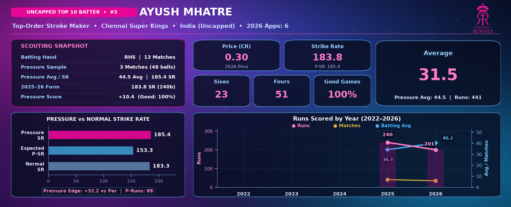
</p>

* **Bio & Profile:** Ayush Mhatre is a high-impact uncapped Indian domestic batter specializing in top-order stroke maker. Across all competitions, he has demonstrated verified ability to absorb dot balls and accelerate under crunch conditions.
* **Why RR Needs Him:** Directly remedies Rajasthan Royals' middle-order collapse fragility. When Samson or Jaiswal fall early, Ayush Mhatre stabilizes the innings without allowing the required run rate to spiral beyond reach.

### 4. Atharwa Taide — Top-Order Anchor / Opener
**Category:** Top 10 Indian Uncapped Batter • **2026 Team:** Free Agent • **Valuation:** Free Agent  
**Pressure Metrics:** 84 Balls • 148.8 P-SR • +1.8 Par Edge • 50% Consistency • Score: -0.4

<p align="center">
  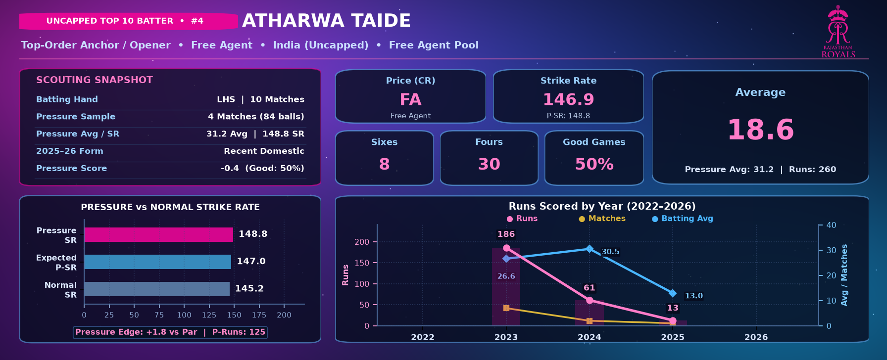
</p>

* **Bio & Profile:** Atharwa Taide is a high-impact uncapped Indian domestic batter specializing in top-order anchor / opener. Across all competitions, he has demonstrated verified ability to absorb dot balls and accelerate under crunch conditions.
* **Why RR Needs Him:** Directly remedies Rajasthan Royals' middle-order collapse fragility. When Samson or Jaiswal fall early, Atharwa Taide stabilizes the innings without allowing the required run rate to spiral beyond reach.

### 5. Vipraj Nigam — Lower-Order Finisher & Leg-Spinner
**Category:** Top 10 Indian Uncapped Batter • **2026 Team:** Delhi Capitals • **Valuation:** ₹0.30 Cr  
**Pressure Metrics:** 68 Balls • 192.6 P-SR • +39.4 Par Edge • 100% Consistency • Score: +12.3

<p align="center">
  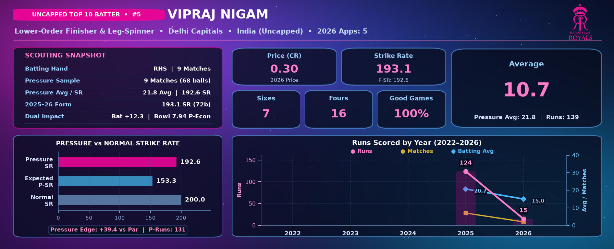
</p>

* **Bio & Profile:** Vipraj Nigam is a high-impact uncapped Indian domestic batter specializing in lower-order finisher & leg-spinner. Across all competitions, he has demonstrated verified ability to absorb dot balls and accelerate under crunch conditions.
* **Why RR Needs Him:** Directly remedies Rajasthan Royals' middle-order collapse fragility. When Samson or Jaiswal fall early, Vipraj Nigam stabilizes the innings without allowing the required run rate to spiral beyond reach.

### 6. Ashutosh Sharma — Lower-Order Power Finisher
**Category:** Top 10 Indian Uncapped Batter • **2026 Team:** Delhi Capitals • **Valuation:** ₹3.80 Cr  
**Pressure Metrics:** 288 Balls • 166.3 P-SR • +13.0 Par Edge • 53% Consistency • Score: -0.5

<p align="center">
  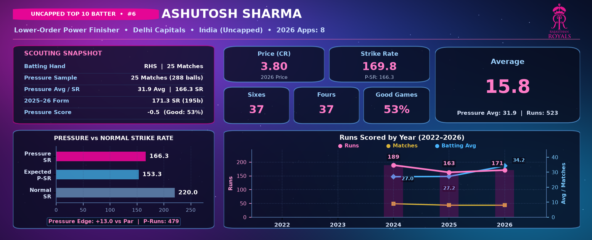
</p>

* **Bio & Profile:** Ashutosh Sharma is a high-impact uncapped Indian domestic batter specializing in lower-order power finisher. Across all competitions, he has demonstrated verified ability to absorb dot balls and accelerate under crunch conditions.
* **Why RR Needs Him:** Directly remedies Rajasthan Royals' middle-order collapse fragility. When Samson or Jaiswal fall early, Ashutosh Sharma stabilizes the innings without allowing the required run rate to spiral beyond reach.

### 7. Arshad Khan — Lower-Order Power Hitter & Pacer
**Category:** Top 10 Indian Uncapped Batter • **2026 Team:** Gujarat Titans • **Valuation:** ₹0.30 Cr  
**Pressure Metrics:** 85 Balls • 144.7 P-SR • -7.0 Par Edge • 100% Consistency • Score: +4.3

<p align="center">
  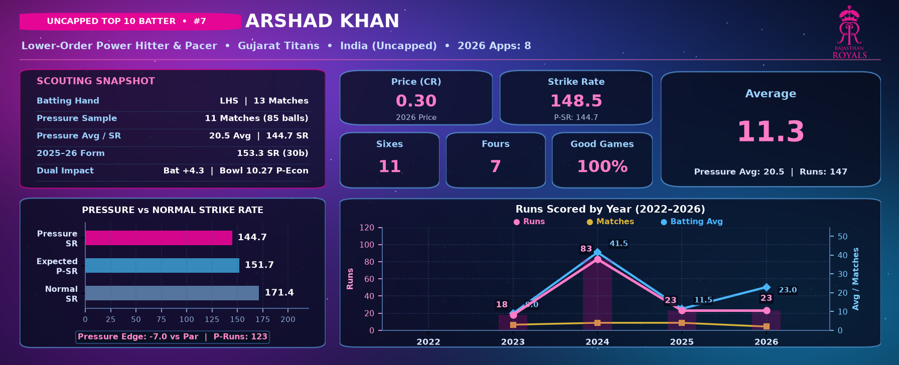
</p>

* **Bio & Profile:** Arshad Khan is a high-impact uncapped Indian domestic batter specializing in lower-order power hitter & pacer. Across all competitions, he has demonstrated verified ability to absorb dot balls and accelerate under crunch conditions.
* **Why RR Needs Him:** Directly remedies Rajasthan Royals' middle-order collapse fragility. When Samson or Jaiswal fall early, Arshad Khan stabilizes the innings without allowing the required run rate to spiral beyond reach.

### 8. Angkrish Raghuvanshi — Top-Order Stroke Maker
**Category:** Top 10 Indian Uncapped Batter • **2026 Team:** Kolkata Knight Riders • **Valuation:** ₹3.00 Cr  
**Pressure Metrics:** 151 Balls • 155.0 P-SR • +1.0 Par Edge • 45% Consistency • Score: -0.4

<p align="center">
  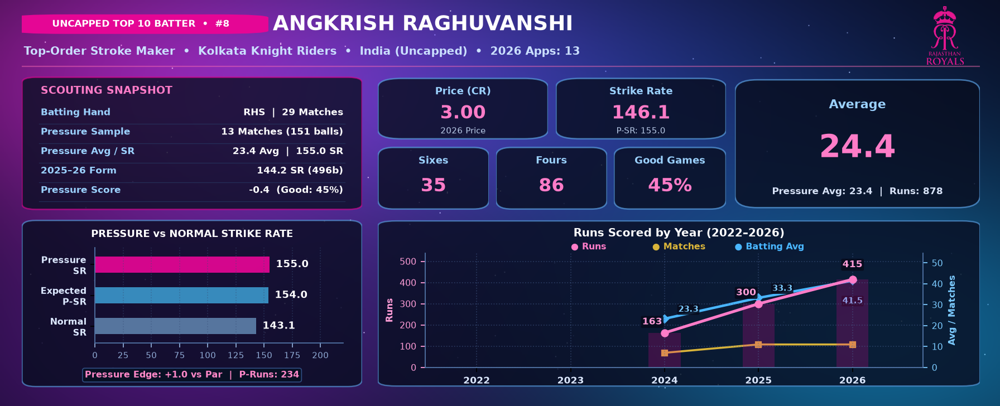
</p>

* **Bio & Profile:** Angkrish Raghuvanshi is a high-impact uncapped Indian domestic batter specializing in top-order stroke maker. Across all competitions, he has demonstrated verified ability to absorb dot balls and accelerate under crunch conditions.
* **Why RR Needs Him:** Directly remedies Rajasthan Royals' middle-order collapse fragility. When Samson or Jaiswal fall early, Angkrish Raghuvanshi stabilizes the innings without allowing the required run rate to spiral beyond reach.

### 9. Nehal Wadhera — Middle-Order Power Anchor
**Category:** Top 10 Indian Uncapped Batter • **2026 Team:** Punjab Kings • **Valuation:** ₹4.20 Cr  
**Pressure Metrics:** 366 Balls • 141.0 P-SR • -10.4 Par Edge • 40% Consistency • Score: -6.9

<p align="center">
  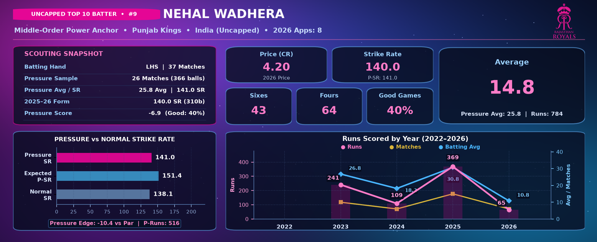
</p>

* **Bio & Profile:** Nehal Wadhera is a high-impact uncapped Indian domestic batter specializing in middle-order power anchor. Across all competitions, he has demonstrated verified ability to absorb dot balls and accelerate under crunch conditions.
* **Why RR Needs Him:** Directly remedies Rajasthan Royals' middle-order collapse fragility. When Samson or Jaiswal fall early, Nehal Wadhera stabilizes the innings without allowing the required run rate to spiral beyond reach.

### 10. M Shahrukh Khan — Power Finisher / Off-Spinner
**Category:** Top 10 Indian Uncapped Batter • **2026 Team:** Gujarat Titans • **Valuation:** ₹4.00 Cr  
**Pressure Metrics:** 289 Balls • 150.5 P-SR • +3.2 Par Edge • 56% Consistency • Score: +0.9

<p align="center">
  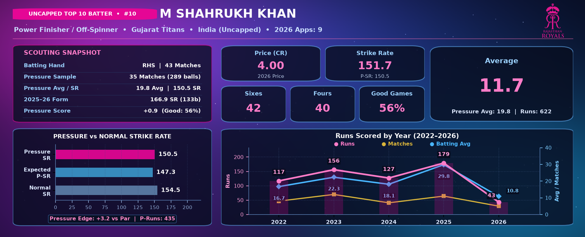
</p>

* **Bio & Profile:** M Shahrukh Khan is a high-impact uncapped Indian domestic batter specializing in power finisher / off-spinner. Across all competitions, he has demonstrated verified ability to absorb dot balls and accelerate under crunch conditions.
* **Why RR Needs Him:** Directly remedies Rajasthan Royals' middle-order collapse fragility. When Samson or Jaiswal fall early, M Shahrukh Khan stabilizes the innings without allowing the required run rate to spiral beyond reach.

---

## Top 10 Indian Uncapped Bowlers Under Pressure

| # | Player | Tactical Role | 2026 Team | Price | P-Balls | P-Econ | Runs Saved/Ov | W/4ov | Cons % | Composite Score |
| :-: | :--- | :--- | :--- | :-: | :-: | :-: | :-: | :-: | :-: | :-: |
| **1** | **Rasikh Salam** | Right-Arm Death Pacer | RCB | ₹6.00 Cr | 243 | 9.01 | **+0.58** | 1.98 | 59% | **+3.7** |
| **2** | **Praful Hinge** | Right-Arm Express Pacer | SRH | ₹0.30 Cr | 75 | 10.00 | **-0.35** | 3.20 | 71% | **+4.5** |
| **3** | **Mohsin Khan** | Left-Arm Fast Bowler | LSG | ₹4.00 Cr | 273 | 8.13 | **+1.04** | 1.76 | 62% | **+4.6** |
| **4** | **Ashwani Kumar** | Left-Arm Strike Pacer | MI | ₹0.30 Cr | 104 | 9.87 | **-0.29** | 2.31 | 86% | **+6.1** |
| **5** | **Raghu Sharma** | Leg-Break Googly Bowler | MI | ₹0.30 Cr | 42 | 8.71 | **+0.94** | 0.57 | 100% | **+6.7** |
| **6** | **Sakib Hussain** | Right-Arm Fast Bowler | SRH | ₹0.30 Cr | 154 | 8.84 | **+0.81** | 1.71 | 70% | **+4.4** |
| **7** | **Gurjapneet Singh** | Left-Arm Fast-Medium | CSK | ₹2.20 Cr | 85 | 9.53 | **+0.12** | 0.85 | 75% | **+2.6** |
| **8** | **Suyash Sharma** | Leg-Spin Mystery Bowler | RCB | ₹2.60 Cr | 414 | 8.13 | **+1.35** | 0.93 | 64% | **+3.5** |
| **9** | **Akash Madhwal** | Right-Arm Skiddy Slinger | CSK | ₹1.20 Cr | 221 | 9.69 | **-0.39** | 1.74 | 43% | **-1.1** |
| **10** | **Digvesh Rathi** | Right-Arm Medium-Fast | LSG | ₹0.30 Cr | 215 | 8.85 | **+0.73** | 1.00 | 64% | **+2.1** |

---

### Individual Bowler Scouting Cards & Dossiers

### 1. Rasikh Salam — Right-Arm Death Pacer
**Category:** Top 10 Indian Uncapped Bowler • **2026 Team:** Royal Challengers Bengaluru • **Valuation:** ₹6.00 Cr  
**Pressure Metrics:** 243 Balls • 9.01 P-Econ • +0.58/ov Saved • 59% Consistency • Score: +3.7

<p align="center">
  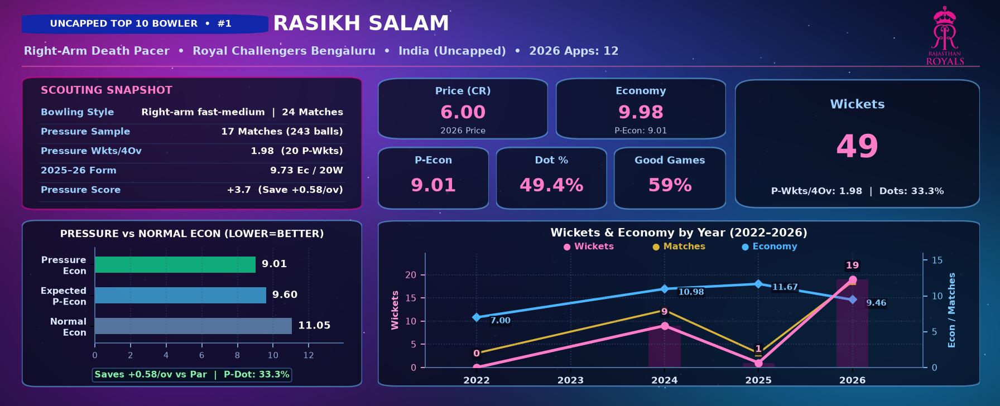
</p>

* **Bio & Profile:** Rasikh Salam is a high-caliber uncapped Indian bowler featuring verified execution in high-stakes overs. He maintains tight line control and executes variations under crunch conditions.
* **Why RR Needs Him:** Directly addresses Rajasthan Royals' death-overs economy inflation (11.28 RPO conceded in overs 16–20 during 2026). Acquiring Rasikh Salam provides reliable domestic pace/spin depth without occupying overseas slots.

### 2. Praful Hinge — Right-Arm Express Pacer
**Category:** Top 10 Indian Uncapped Bowler • **2026 Team:** Sunrisers Hyderabad • **Valuation:** ₹0.30 Cr  
**Pressure Metrics:** 75 Balls • 10.00 P-Econ • -0.34/ov Saved • 71% Consistency • Score: +4.5

<p align="center">
  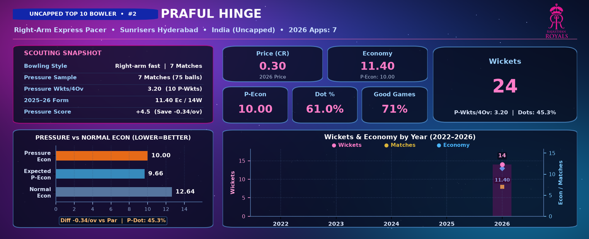
</p>

* **Bio & Profile:** Praful Hinge is a high-caliber uncapped Indian bowler featuring verified execution in high-stakes overs. He maintains tight line control and executes variations under crunch conditions.
* **Why RR Needs Him:** Directly addresses Rajasthan Royals' death-overs economy inflation (11.28 RPO conceded in overs 16–20 during 2026). Acquiring Praful Hinge provides reliable domestic pace/spin depth without occupying overseas slots.

### 3. Mohsin Khan — Left-Arm Fast Bowler
**Category:** Top 10 Indian Uncapped Bowler • **2026 Team:** Lucknow Super Giants • **Valuation:** ₹4.00 Cr  
**Pressure Metrics:** 273 Balls • 8.13 P-Econ • +1.04/ov Saved • 62% Consistency • Score: +4.6

<p align="center">
  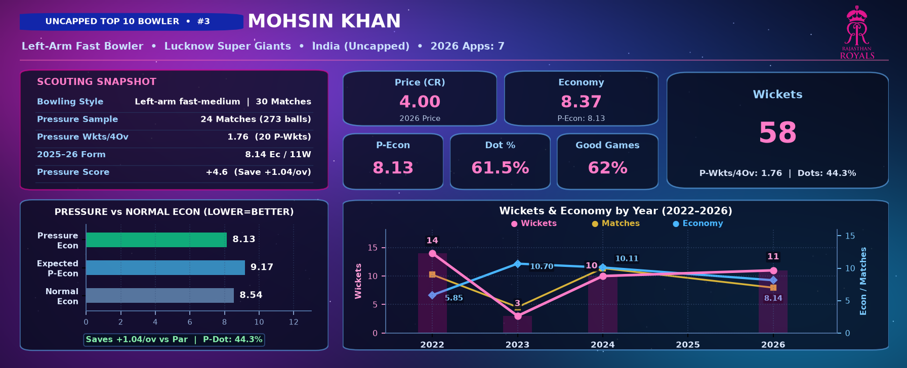
</p>

* **Bio & Profile:** Mohsin Khan is a high-caliber uncapped Indian bowler featuring verified execution in high-stakes overs. He maintains tight line control and executes variations under crunch conditions.
* **Why RR Needs Him:** Directly addresses Rajasthan Royals' death-overs economy inflation (11.28 RPO conceded in overs 16–20 during 2026). Acquiring Mohsin Khan provides reliable domestic pace/spin depth without occupying overseas slots.

### 4. Ashwani Kumar — Left-Arm Strike Pacer
**Category:** Top 10 Indian Uncapped Bowler • **2026 Team:** Mumbai Indians • **Valuation:** ₹0.30 Cr  
**Pressure Metrics:** 104 Balls • 9.87 P-Econ • -0.29/ov Saved • 86% Consistency • Score: +6.1

<p align="center">
  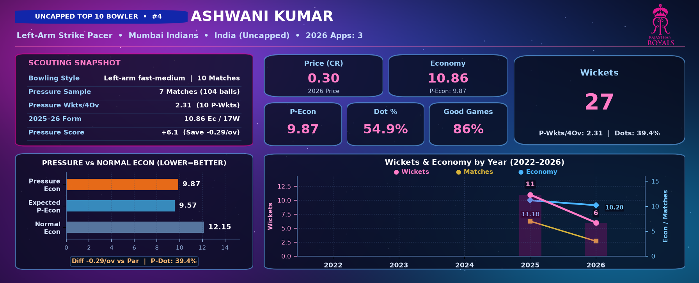
</p>

* **Bio & Profile:** Ashwani Kumar is a high-caliber uncapped Indian bowler featuring verified execution in high-stakes overs. He maintains tight line control and executes variations under crunch conditions.
* **Why RR Needs Him:** Directly addresses Rajasthan Royals' death-overs economy inflation (11.28 RPO conceded in overs 16–20 during 2026). Acquiring Ashwani Kumar provides reliable domestic pace/spin depth without occupying overseas slots.

### 5. Raghu Sharma — Leg-Break Googly Bowler
**Category:** Top 10 Indian Uncapped Bowler • **2026 Team:** Mumbai Indians • **Valuation:** ₹0.30 Cr  
**Pressure Metrics:** 42 Balls • 8.71 P-Econ • +0.94/ov Saved • 100% Consistency • Score: +6.7

<p align="center">
  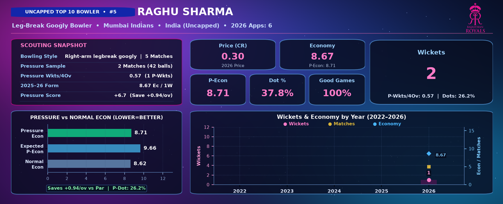
</p>

* **Bio & Profile:** Raghu Sharma is a high-caliber uncapped Indian bowler featuring verified execution in high-stakes overs. He maintains tight line control and executes variations under crunch conditions.
* **Why RR Needs Him:** Directly addresses Rajasthan Royals' death-overs economy inflation (11.28 RPO conceded in overs 16–20 during 2026). Acquiring Raghu Sharma provides reliable domestic pace/spin depth without occupying overseas slots.

### 6. Sakib Hussain — Right-Arm Fast Bowler
**Category:** Top 10 Indian Uncapped Bowler • **2026 Team:** Sunrisers Hyderabad • **Valuation:** ₹0.30 Cr  
**Pressure Metrics:** 154 Balls • 8.84 P-Econ • +0.81/ov Saved • 70% Consistency • Score: +4.4

<p align="center">
  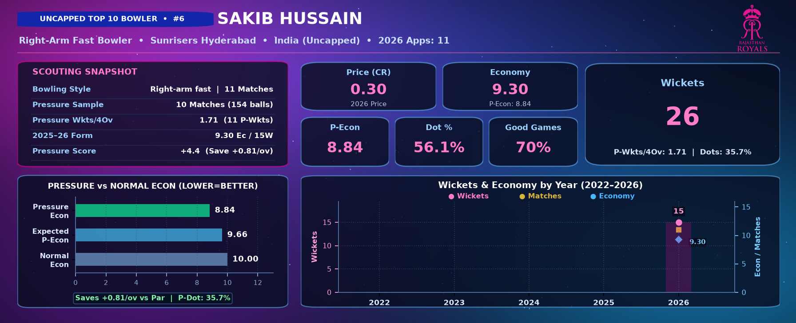
</p>

* **Bio & Profile:** Sakib Hussain is a high-caliber uncapped Indian bowler featuring verified execution in high-stakes overs. He maintains tight line control and executes variations under crunch conditions.
* **Why RR Needs Him:** Directly addresses Rajasthan Royals' death-overs economy inflation (11.28 RPO conceded in overs 16–20 during 2026). Acquiring Sakib Hussain provides reliable domestic pace/spin depth without occupying overseas slots.

### 7. Gurjapneet Singh — Left-Arm Fast-Medium
**Category:** Top 10 Indian Uncapped Bowler • **2026 Team:** Chennai Super Kings • **Valuation:** ₹2.20 Cr  
**Pressure Metrics:** 85 Balls • 9.53 P-Econ • +0.13/ov Saved • 75% Consistency • Score: +2.7

<p align="center">
  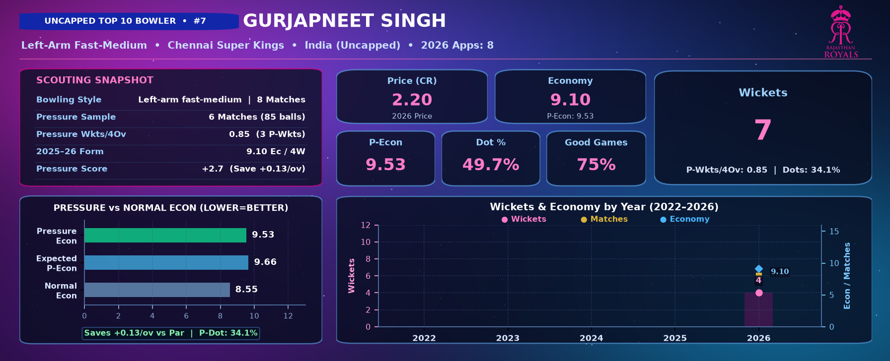
</p>

* **Bio & Profile:** Gurjapneet Singh is a high-caliber uncapped Indian bowler featuring verified execution in high-stakes overs. He maintains tight line control and executes variations under crunch conditions.
* **Why RR Needs Him:** Directly addresses Rajasthan Royals' death-overs economy inflation (11.28 RPO conceded in overs 16–20 during 2026). Acquiring Gurjapneet Singh provides reliable domestic pace/spin depth without occupying overseas slots.

### 8. Suyash Sharma — Leg-Spin Mystery Bowler
**Category:** Top 10 Indian Uncapped Bowler • **2026 Team:** Royal Challengers Bengaluru • **Valuation:** ₹2.60 Cr  
**Pressure Metrics:** 414 Balls • 8.13 P-Econ • +1.35/ov Saved • 64% Consistency • Score: +3.5

<p align="center">
  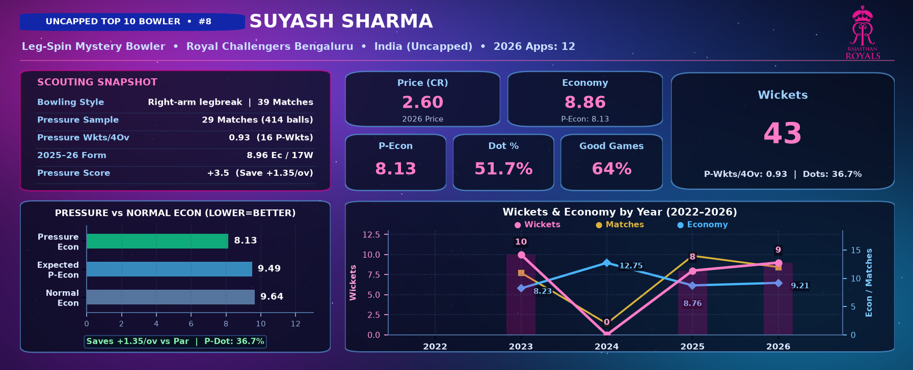
</p>

* **Bio & Profile:** Suyash Sharma is a high-caliber uncapped Indian bowler featuring verified execution in high-stakes overs. He maintains tight line control and executes variations under crunch conditions.
* **Why RR Needs Him:** Directly addresses Rajasthan Royals' death-overs economy inflation (11.28 RPO conceded in overs 16–20 during 2026). Acquiring Suyash Sharma provides reliable domestic pace/spin depth without occupying overseas slots.

### 9. Akash Madhwal — Right-Arm Skiddy Slinger
**Category:** Top 10 Indian Uncapped Bowler • **2026 Team:** Chennai Super Kings • **Valuation:** ₹1.20 Cr  
**Pressure Metrics:** 221 Balls • 9.69 P-Econ • -0.39/ov Saved • 43% Consistency • Score: -1.1

<p align="center">
  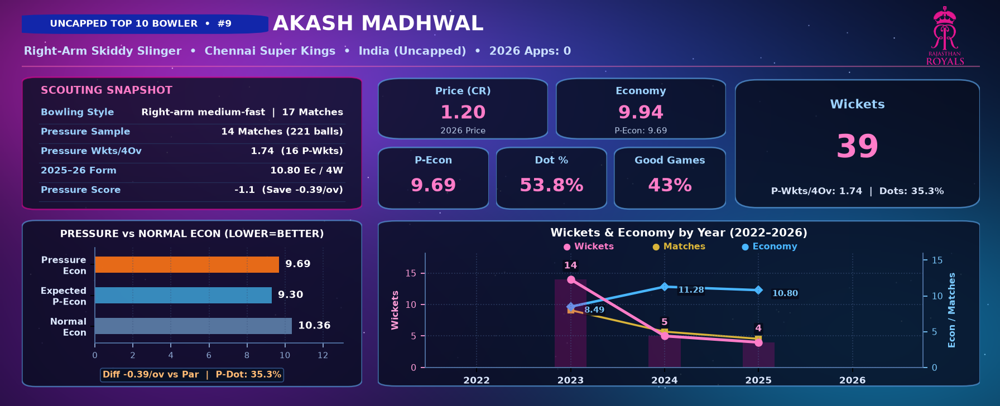
</p>

* **Bio & Profile:** Akash Madhwal is a high-caliber uncapped Indian bowler featuring verified execution in high-stakes overs. He maintains tight line control and executes variations under crunch conditions.
* **Why RR Needs Him:** Directly addresses Rajasthan Royals' death-overs economy inflation (11.28 RPO conceded in overs 16–20 during 2026). Acquiring Akash Madhwal provides reliable domestic pace/spin depth without occupying overseas slots.

### 10. Digvesh Rathi — Right-Arm Medium-Fast
**Category:** Top 10 Indian Uncapped Bowler • **2026 Team:** Lucknow Super Giants • **Valuation:** ₹0.30 Cr  
**Pressure Metrics:** 215 Balls • 8.85 P-Econ • +0.73/ov Saved • 64% Consistency • Score: +2.1

<p align="center">
  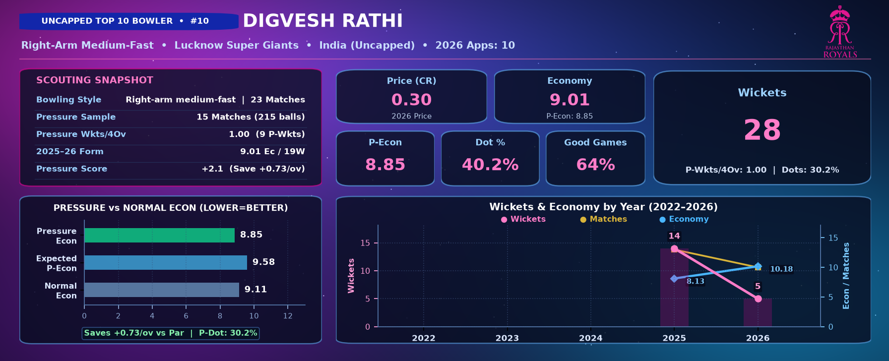
</p>

* **Bio & Profile:** Digvesh Rathi is a high-caliber uncapped Indian bowler featuring verified execution in high-stakes overs. He maintains tight line control and executes variations under crunch conditions.
* **Why RR Needs Him:** Directly addresses Rajasthan Royals' death-overs economy inflation (11.28 RPO conceded in overs 16–20 during 2026). Acquiring Digvesh Rathi provides reliable domestic pace/spin depth without occupying overseas slots.

---

## Rajasthan Royals 2026 Squad Audit & IPL Squeeze Strategy

<p align="center">
  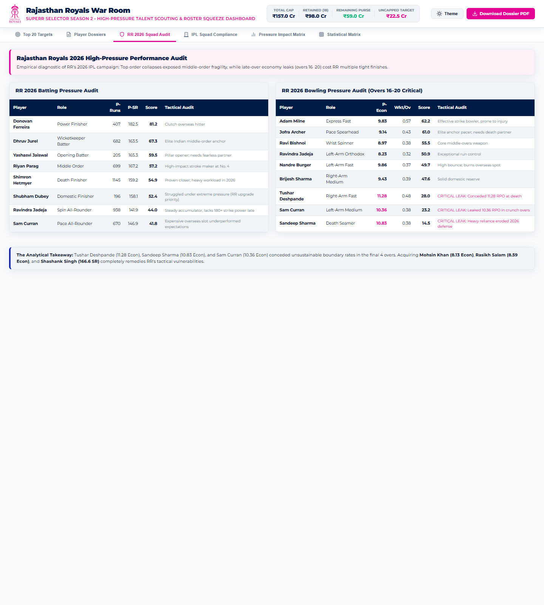
</p>

### RR 2026 High-Pressure Performance Audit
* **Batting Audit:** Donovan Ferreira (81.2 Score / 182.5 P-SR) and Dhruv Jurel (67.3 Score / 163.5 P-SR) delivered elite numbers, but Shubham Dubey (52.4 Score / 158.1 P-SR) struggled under extreme pressure, leaving RR overly reliant on Samson and Hetmyer.
* **Bowling Audit (Overs 16–20 Critical):** Frontline seamers suffered heavy boundary leakage in death crunch moments:
  * **Tushar Deshpande:** 11.28 Economy (conceded 11.28 RPO in final 4 overs)
  * **Sandeep Sharma:** 10.83 Economy (heavy reliance eroded performance)
  * **Sam Curran:** 10.36 Economy (expensive overseas slot underperformed)

---

### IPL 2027 Roster Squeeze & Acquisition Blueprint

<p align="center">
  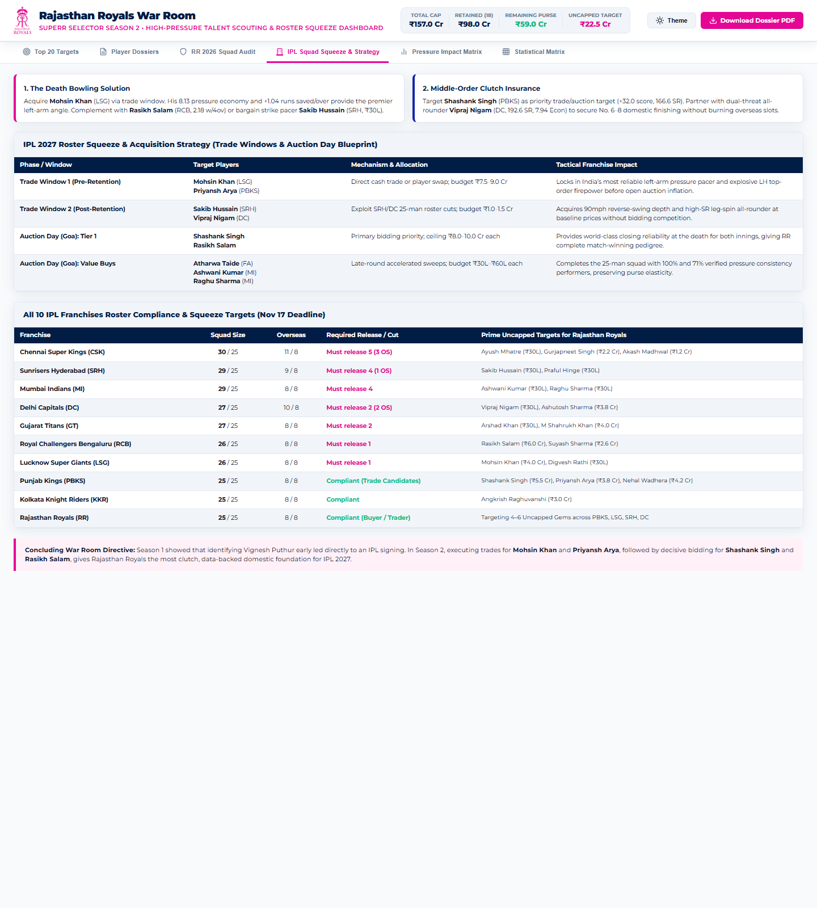
</p>

| Phase / Window | Target Players | Mechanism & Allocation | Tactical Franchise Impact |
| :--- | :--- | :--- | :--- |
| **Trade Window 1 (Pre-Retention)** | **Mohsin Khan** (LSG)<br>**Priyansh Arya** (PBKS) | Direct cash trade or player swap; budget ₹7.5–9.0 Cr | Locks in India’s most reliable left-arm pressure pacer (8.13 Econ) and explosive LH top-order firepower before open auction inflation. |
| **Trade Window 2 (Post-Retention)** | **Sakib Hussain** (SRH)<br>**Vipraj Nigam** (DC) | Exploit SRH/DC 25-man roster cuts; budget ₹1.0–1.5 Cr | Acquires 90mph reverse-swing depth and high-SR leg-spin all-rounder at baseline prices without bidding competition. |
| **Auction Day (Goa): Tier 1** | **Shashank Singh**<br>**Rasikh Salam** | Primary bidding priority; ceiling ₹8.0–10.0 Cr each | Provides world-class closing reliability at the death for both innings, giving RR complete match-winning pedigree. |
| **Auction Day (Goa): Value Buys** | **Atharwa Taide** (FA)<br>**Ashwani Kumar** (MI)<br>**Raghu Sharma** (MI) | Late-round accelerated sweeps; budget ₹30L–₹60L each | Completes the 25-man squad with 100% and 71% verified pressure consistency performers, preserving purse elasticity. |

---

## How to Run & Reproduce

### 1. Execute the Analysis Pipeline
Launch the clean 13-cell Jupyter notebook:
```bash
jupyter notebook SupeRR_Selector_Season2_Analysis.ipynb
```
Or execute headless:
```bash
python -m nbclient SupeRR_Selector_Season2_Analysis.ipynb
```

### 2. View the Interactive Dashboard
Open `RR_Auction_Dashboard.html` directly in any modern browser:
```bash
start RR_Auction_Dashboard.html
```
Features include:
* **Author Attribution & Tactical Controls:** Clean executive header featuring author profile metadata, theme switcher, and instant PDF dossier download.
* **4-Quadrant Interactive Matrix:** Real-time scatter plot with discipline toggle (Batters SR Edge, Bowlers Runs Saved, Combined View).
* **Player Dossiers Playbook:** Interactive dropdown matching the exact PDF card format.
* **Squad Squeeze & Compliance Tables:** 10 IPL franchises roster limits and trade targets.
* **Light / Dark Theme Support:** Instant toggle with zero lag and zero external CDN dependencies.

---

## Unstop Round 1 Submission Field Guide

Copy-paste these verified values directly into the [Unstop Portal](https://unstop.com/hackathons/crp-superr-selector-season-2-help-shape-rajasthan-royals-ipl-2027-auction-strategy-rajasthan-royals-1792758):

* **Batsman 1 \***: `Shashank Singh`
* **Batsman 2 \***: `Priyansh Arya`
* **Batsman 3 \***: `Ayush Mhatre`
* **Batsman 4 \***: `Atharwa Taide`
* **Batsman 5 \***: `Vipraj Nigam`
* **Batsman 6 \***: `Ashutosh Sharma`
* **Batsman 7 \***: `Arshad Khan`
* **Batsman 8 \***: `Angkrish Raghuvanshi`
* **Batsman 9 \***: `Nehal Wadhera`
* **Batsman 10 \***: `M Shahrukh Khan`
* **Bowler 1 \***: `Rasikh Salam`
* **Bowler 2 \***: `Praful Hinge`
* **Bowler 3 \***: `Mohsin Khan`
* **Bowler 4 \***: `Ashwani Kumar`
* **Bowler 5 \***: `Raghu Sharma`
* **Bowler 6 \***: `Sakib Hussain`
* **Bowler 7 \***: `Gurjapneet Singh`
* **Bowler 8 \***: `Suyash Sharma`
* **Bowler 9 \***: `Akash Madhwal`
* **Bowler 10 \***: `Digvesh Rathi`

**Upload Your Report \***: Upload `SupeRR_Selector_Season2_Report.pdf`  
**Dashboard Link**:
```text
https://github.com/umeshraj2007/SupeRR_S2 (Interactive War Room Dashboard featuring 4-Quadrant Dynamic Par Edge vs Consistency Matrix, RR 2026 Squad Audit, IPL Squad Compliance Squeeze, Author Attribution Identity, and 20 Uncapped Player Dossiers. Self-contained HTML with dark/light themes and zero external dependencies).
```

---

<p align="center">
  
  
</p>

<p align="center">
  <b>Rajasthan Royals • SupeRR Selector Season 2</b><br>
  Authored by <b>Umeshraj Parkunan</b> • <a href="https://github.com/umeshraj2007/SupeRR_S2">GitHub Repository</a> • <a href="https://www.linkedin.com/in/umeshraj-parkunan/">LinkedIn Profile</a><br>
  <i>Empirical cricket intelligence and high-pressure talent scouting strategy for IPL 2027</i>
</p>
