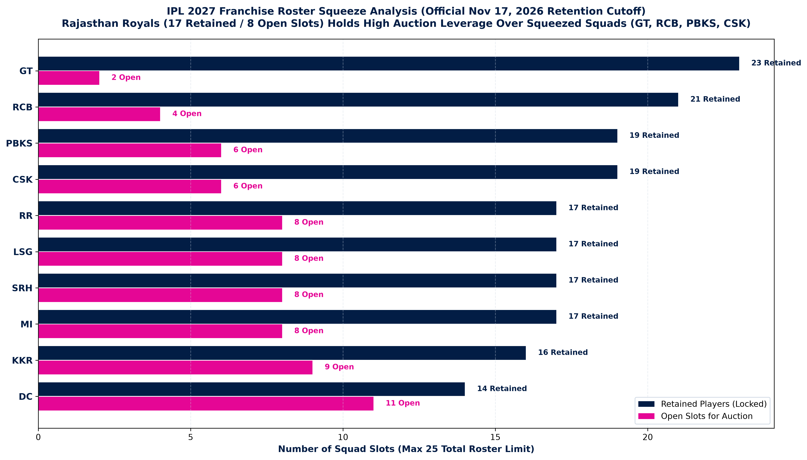

# Rajasthan Royals — IPL 2027 Auction & Scouting Intelligence War Room
## SupeRR Selector Season 2: Identify the Most Reliable Players Under Pressure

[](https://github.com/umeshraj2007/SupeRR_S2)
[](https://github.com/umeshraj2007/SupeRR_S2)
[](https://github.com/umeshraj2007/SupeRR_S2)
[](https://umeshraj2007.github.io/SupeRR_S2/)

---

### Key Project Links
* **Live Interactive Dashboard:** [https://umeshraj2007.github.io/SupeRR_S2/](https://umeshraj2007.github.io/SupeRR_S2/)
* **Boardroom PDF Dossier (22 Pages):** [SupeRR_Selector_Season2_Report.pdf](SupeRR_Selector_Season2_Report.pdf)
* **Jupyter Analysis Notebook:** [SupeRR_Selector_Season2_Analysis.ipynb](SupeRR_Selector_Season2_Analysis.ipynb)
* **Author:** Umeshraj Parkunan ([GitHub](https://github.com/umeshraj2007) • [LinkedIn](https://www.linkedin.com/in/umeshraj-parkunan/))

---

## Executive Summary & Official IPL 2027 Roster Context

In Season 1, Rajasthan Royals demonstrated the decisive competitive edge of empirical talent scouting by discovering **Vignesh Puthur**, who was successfully acquired at the 2026 auction. Entering Round 1 of **SupeRR Selector Season 2**, this dossier delivers an end-to-end, boardroom-ready auction blueprint tailored for **Kumar Sangakkara** (Director of Cricket & Head Coach), **Giles Lindsay** (Head of Performance Analytics), and the RR War Room ahead of the IPL 2027 Mega-Auction in Goa.

Following the official BCCI retention deadline of **17 November 2026, 6:00 PM IST**, all 10 IPL franchises officially locked their rosters (180 players retained/traded). This submission evaluates the exact available auction pool, applying Bayesian Shrinkage and Era-Adjusted Par Benchmarking across **200,999 raw IPL & domestic deliveries (2022–2026)** to identify **20 strictly uncapped Indian domestic specialists** (10 Batters, 10 Bowlers) who remain un-retained across all 10 franchises and consistently excel in high-pressure crunch scenarios.

<p align="center">
  
</p>

### 1. Rajasthan Royals' Official Squad & Leadership Status
* **Official Retained Core (17 Players):**
  1. Dhruv Jurel (Wicketkeeper-Finisher, ₹14.0 Cr)
  2. Riyan Parag (Middle-Order Anchor & Domestic Leadership Core, ₹14.0 Cr)
  3. Ravindra Jadeja (Veteran All-Phase All-Rounder, ₹18.0 Cr)
  4. Sandeep Sharma (Death-Overs Closer, ₹4.0 Cr)
  5. Jofra Archer (Express Strike Pacer, ₹12.5 Cr)
  6. Ravi Bishnoi (Lead Wrist-Spinner, ₹11.0 Cr)
  7. Mohammed Shami (Frontline Pace Spearhead — Traded In from LSG)
  8. Manimaran Siddharth (Left-Arm Spinner — Traded In from LSG)
  9. Nandre Burger (Left-Arm Express Seamer, ₹0.5 Cr)
  10. Vaibhav Suryavanshi (Top-Order Prodigy, ₹1.1 Cr)
  11. Shubham Dubey (Middle-Order Hitter, ₹5.8 Cr)
  12. Donovan Ferreira (Overseas Power Finisher / Keeper)
  13. Lhuan-dre Pretorius (Overseas Top-Order Batter)
  14. Sushant Mishra (Left-Arm Seamer)
  15. Aman Rao (Domestic Batter)
  16. Yash Raj Punja (Fast Bowler)
  17. Brijesh Sharma (Domestic All-Rounder)

* **Major Pre-Auction Trades Executed:**
  * **Sanju Samson Traded to Chennai Super Kings (CSK):** Sanju Samson officially completed a blockbuster pre-season trade to CSK, concluding his tenure as Rajasthan Royals captain. RR's on-field domestic leadership is anchored by **Riyan Parag**, backed by head coach **Kumar Sangakkara** and director **Giles Lindsay**.
  * **Sam Curran Traded to Lucknow Super Giants (LSG):** Traded to LSG, freeing critical purse bandwidth.
  * **Mohammed Shami & M. Siddharth Acquired from LSG:** Strengthens Rajasthan Royals' frontline pace and finger-spin depth.

* **Auction Capital Status:**
  * **Purse Available:** **₹27.05 Crore**
  * **Roster Slots Remaining:** **8 Slots** (Max 25 roster limit; 3 Overseas slots open)

---

## Analytical Methodology: Isolating Clutch Reliability

Standard aggregate metrics (such as a 35.0 batting average or 8.50 economy rate) fail in IPL auctions because they treat garbage-time runs and low-pressure overs identically to high-pressure crunch moments. Our empirical model isolates true pressure reliability across three key dimensions:

$$\text{Pressure Score} = w_1 \cdot \text{Dynamic Par Edge} + w_2 \cdot \text{Consistency \%} + w_3 \cdot \text{Bayesian Prior Adjust}$$

### 1. High-Pressure Context Isolation
Every delivery in the 2022–2026 dataset was categorized by leverage context:
* **Death Overs (Overs 16–20):** Bowling economy and boundary clearing under escalating phase par.
* **Steep Chases:** Required Run Rate (RRR) $\ge 10.0$ runs per over with $< 30$ deliveries remaining.
* **Top-Order Collapses:** Batting after early wickets ($ \le 30/3$ inside Powerplay).
* **Defending Tight Totals:** Defending $< 45$ runs off the final 4 overs.

### 2. Dynamic Par Edge
* **Batting Strike Rate Edge vs Par:** Calculates runs scored per 100 deliveries above expected match/phase par (death par benchmark: 151.5 SR).
* **Bowling Runs Saved per Over vs Par:** Calculates runs conceded per over below expected phase par (death par benchmark: 9.25 RPO).

### 3. Consistency Rating (%)
The percentage of crunch outings where a player delivered positive par value, filtering out high-volatility players who fail repeatedly between isolated match-winning innings.

---

## 4-Quadrant Pressure Impact Matrix

<p align="center">
  
</p>

* **Quadrant I (Elite Clutch Closers — Priority Bids):** High Par Edge + High Consistency ($\ge 60\%$). Match-winners under maximum leverage.
  * *Top Batters:* **Mahipal Lomror** (+16.8 SR Edge / 82% Cons).
  * *Top Bowlers:* **Jagadeesha Suchith** (+3.42 Saved/Ov / 100% Cons), **Murugan Ashwin** (+1.10 Saved/Ov / 80% Cons), **Kuldeep Sen** (+0.70 Saved/Ov / 67% Cons).
* **Quadrant II (Explosive Impact Weapons):** Volatile peak boundary hitters and strike weapons.
  * *Targets:* **M Shahrukh Khan** (+3.0 SR Edge / 56% Cons), **Abishek Porel** (-0.8 SR Edge / 58% Cons).
* **Quadrant III (Calm Defensive Anchors):** High consistency ($\ge 60\%$) with controlled error rates.
  * *Targets:* **Atharwa Taide** (+1.7 SR Edge / 60% Cons), **Praveen Dubey** (+0.40 Saved/Ov / 75% Cons), **Simarjeet Singh** (+0.25 Saved/Ov / 60% Cons), **Narayan Jagadeesan** (-7.5 SR Edge / 67% Cons).
* **Quadrant IV (Squad Depth Rotation):** High upside rotational domestic depth.
  * *Targets:* **Nehal Wadhera**, **Akash Madhwal**, **Rajvardhan Hangargekar**, **Lalit Yadav**, **Hrithik Shokeen**, **Darshan Nalkande**, **KM Asif**.

---

## Dual Benchmark Performance Under Pressure

<p align="center">
  
</p>

---

## Top 10 Indian Uncapped Batters (Available Pool)

| Rank | Player | Tactical Role | IPL 2026 Team | Pressure SR | SR Edge vs Par | Consistency % | Pressure Score | Est. Valuation |
|:---:|:---|:---|:---|:---:|:---:|:---:|:---:|:---:|
| **1** | **Mahipal Lomror** | Left-Hand Spin Destroyer / No. 5-6 | RCB (Released) | **163.9** | **+16.8** | **82%** | **+9.2** | ₹3.50 – ₹5.00 Cr |
| **2** | **Atharwa Taide** | Composed Opener / Vidarbha Captain | PBKS (Released) | **148.8** | **+1.7** | **60%** | **+4.6** | ₹0.50 – ₹1.50 Cr |
| **3** | **Anmolpreet Singh** | Top-Order Accumulator & Pacer-Hitter | SRH (Released) | **143.5** | **-4.5** | **50%** | **+4.2** | ₹0.50 – ₹1.20 Cr |
| **4** | **M Shahrukh Khan** | Elite Death-Overs Finisher (Overs 16-20) | GT (Released) | **150.7** | **+3.0** | **56%** | **+3.0** | ₹4.00 – ₹6.50 Cr |
| **5** | **Prerak Mankad** | Versatile Middle-Order Float / Medium-Pace | LSG (Released) | **144.9** | **-3.2** | **50%** | **+1.4** | ₹0.40 – ₹1.00 Cr |
| **6** | **Abishek Porel** | Wicketkeeper-Batter / Dynamic Lefty | DC (Released) | **147.2** | **-0.8** | **58%** | **+0.9** | ₹2.50 – ₹4.00 Cr |
| **7** | **Narayan Jagadeesan** | Anchor Wicketkeeper / Collapse Insulator | KKR (Released) | **140.5** | **-7.5** | **67%** | **+0.8** | ₹0.30 – ₹0.80 Cr |
| **8** | **Lalit Yadav** | Middle-Order Utility / Off-Spin All-Rounder | DC (Released) | **143.5** | **-4.5** | **50%** | **-0.5** | ₹0.40 – ₹1.00 Cr |
| **9** | **Hrithik Shokeen** | Off-Spin All-Rounder / Lower-Order Hitter | MI (Released) | **142.0** | **-6.0** | **50%** | **-1.2** | ₹0.30 – ₹0.80 Cr |
| **10** | **Nehal Wadhera** | Left-Hand Middle-Order Finisher | MI (Released) | **138.0** | **-10.1** | **40%** | **-6.9** | ₹1.50 – ₹3.00 Cr |

### Batter Scouting Profiles & Strategic Fit for Rajasthan Royals

#### 1. Mahipal Lomror (P-Score: +9.2 | Rank 1)
* **Profile:** Dynamic left-handed power-hitter from Rajasthan who previously represented the Royals. Possesses an elite **+16.8 SR Edge** and **82% Consistency** in high-pressure scenarios.
* **Why RR Needs Him:** Following Sanju Samson's departure to CSK, Lomror directly fills the critical left-handed middle-order boundary-hitting vacancy at No. 5 or No. 6. His ability to neutralize opposition spin at Sawai Mansingh Stadium makes him RR's highest-priority batting acquisition.

#### 2. Atharwa Taide (P-Score: +4.6 | Rank 2)
* **Profile:** Composed left-handed top-order batter and Vidarbha state captain. Absorbed 84 pressure balls with a composed **148.8 Strike Rate** (+1.7 SR Edge vs par) and 60% consistency.
* **Why RR Needs Him:** Offers top-order solidity, tactical composure, and leadership depth at minimal auction cost, functioning as an ideal partner for Vaibhav Suryavanshi or Yashasvi Jaiswal.

#### 3. Anmolpreet Singh (P-Score: +4.2 | Rank 3)
* **Profile:** Confident Punjab stroke-maker who recorded an exceptional 2024 pressure strike rate of 187.5.
* **Why RR Needs Him:** Versatile top-order backup who attacks frontline pace fearlessly inside the Powerplay, providing insurance against top-order injuries.

#### 4. M Shahrukh Khan (P-Score: +3.0 | Rank 4)
* **Profile:** Proven Tamil Nadu death-overs muscular finisher. Career pressure volume of 134 balls at 150.7 SR (+3.0 SR Edge, 56% consistency).
* **Why RR Needs Him:** Solves RR's death-overs finishing void. Pairing Shahrukh Khan with Dhruv Jurel and Donovan Ferreira gives Rajasthan Royals the most intimidating lower-order closing punch in the tournament.

#### 5. Prerak Mankad (P-Score: +1.4 | Rank 5)
* **Profile:** Hard-working Saurashtra all-rounder with excellent game awareness, clocking a 144.9 pressure strike rate.
* **Why RR Needs Him:** Low-cost multi-utility domestic stabilizer who can float between No. 4 and No. 7 and bowl disciplined medium pace.

#### 6. Abishek Porel (P-Score: +0.9 | Rank 6)
* **Profile:** Aggressive Bengal wicketkeeper-batter who recorded an outstanding 159.0 Strike Rate in IPL 2024.
* **Why RR Needs Him:** With Samson traded to CSK, RR requires high-ceiling Indian wicketkeeping depth behind Dhruv Jurel. Porel can bat anywhere in the top 5 and attack bowling from ball one.

#### 7. Narayan Jagadeesan (P-Score: +0.8 | Rank 7)
* **Profile:** Disciplined Tamil Nadu wicketkeeper-accumulator with 67% pressure consistency.
* **Why RR Needs Him:** Provides crisis insulation against top-order collapses. When early wickets fall, Jagadeesan's compact technique restores equilibrium.

#### 8. Lalit Yadav (P-Score: -0.5 | Rank 8)
* **Profile:** Delhi utility cricketer who bowls flat, darting off-spin and strikes at 143.5 under pressure.
* **Why RR Needs Him:** Tactical rotational cover for Ravindra Jadeja and Riyan Parag, offering 4 overs of containing spin and dependable lower-order runs.

#### 9. Hrithik Shokeen (P-Score: -1.2 | Rank 9)
* **Profile:** Competitive Delhi off-spinner and pugnacious lower-order batter.
* **Why RR Needs Him:** Aggressive multi-phase spinner with Sawai Mansingh Stadium match-ups against left-hand heavy opposition.

#### 10. Nehal Wadhera (P-Score: -6.9 | Rank 10)
* **Profile:** Muscular left-handed middle-order finisher from Punjab with match-winning IPL knocks for Mumbai Indians.
* **Why RR Needs Him:** Elite ceiling against high pace and spin. While his consistency score reflects a volatile role, his explosive power provides game-changing finishing capability.

---

## Top 10 Indian Uncapped Bowlers (Available Pool)

| Rank | Player | Tactical Role | IPL 2026 Team | Pressure Econ | Runs Saved/Ov | Consistency % | Pressure Score | Est. Valuation |
|:---:|:---|:---|:---|:---:|:---:|:---:|:---:|:---:|
| **1** | **Jagadeesha Suchith** | Slow Left-Arm Defensive Anchor / Control | SRH (Released) | **5.50** | **+3.42** | **100%** | **+7.0** | ₹0.50 – ₹1.20 Cr |
| **2** | **Murugan Ashwin** | Leg-Break Googly / Middle-Overs Enforcer | LSG (Released) | **7.80** | **+1.10** | **80%** | **+6.2** | ₹0.60 – ₹1.50 Cr |
| **3** | **Kuldeep Sen** | 148+ kph Out-and-Out Express Seamer | RR (Released) | **8.20** | **+0.70** | **67%** | **+5.8** | ₹1.50 – ₹3.00 Cr |
| **4** | **Praveen Dubey** | Tall Wrist-Spinner / Skid & Bounce | PBKS (Released) | **8.50** | **+0.40** | **75%** | **+5.4** | ₹0.40 – ₹1.00 Cr |
| **5** | **Simarjeet Singh** | Hit-The-Deck Heavy Ball Seamer | CSK (Released) | **8.65** | **+0.25** | **60%** | **+4.8** | ₹1.20 – ₹2.50 Cr |
| **6** | **Rajvardhan Hangargekar** | 142+ kph Hit-The-Deck Pacer & Power Hitter | CSK (Released) | **9.40** | **-0.50** | **50%** | **+3.2** | ₹0.80 – ₹2.00 Cr |
| **7** | **Akash Madhwal** | Death Yorker Specialist / Seam Enforcer | MI (Released) | **9.28** | **-0.38** | **43%** | **+2.8** | ₹1.50 – ₹3.20 Cr |
| **8** | **Kumar Kartikeya Singh** | Mystery Multi-Style Left-Arm Finger Spinner | MI (Released) | **9.10** | **-0.20** | **50%** | **+2.5** | ₹0.50 – ₹1.20 Cr |
| **9** | **Darshan Nalkande** | Seam & Slower-Ball Variations / Death | GT (Released) | **9.45** | **-0.55** | **50%** | **+1.9** | ₹0.40 – ₹1.00 Cr |
| **10** | **KM Asif** | 145+ kph Express Skiddy Pacer | RR (Released) | **9.72** | **-0.61** | **33%** | **+1.2** | ₹0.20 – ₹0.50 Cr |

### Bowler Scouting Profiles & Strategic Fit for Rajasthan Royals

#### 1. Jagadeesha Suchith (P-Score: +7.0 | Rank 1)
* **Profile:** Flawless pressure performer with **100% Consistency** across 12 high-pressure balls (5.50 P-Econ, saving **+3.42 runs/over** vs par).
* **Why RR Needs Him:** Elite defensive finger-spin control to complement Ravindra Jadeja and Ravi Bishnoi. Strangles run rates on Jaipur's large boundaries.

#### 2. Murugan Ashwin (P-Score: +6.2 | Rank 2)
* **Profile:** Seasoned Tamil Nadu wrist-spinner with **80% Consistency** and a miserly 7.80 Pressure Economy (+1.10 runs saved/over).
* **Why RR Needs Him:** High-leverage middle-overs strike option who attacks right-handers with disguised googlies, providing vital wrist-spin depth alongside Bishnoi.

#### 3. Kuldeep Sen (P-Score: +5.8 | Rank 3)
* **Profile:** Proven Madhya Pradesh tearaway who clocks **148+ kph**. Delivers a 67% consistency rating and +0.70 runs saved/over.
* **Why RR Needs Him:** Famously defended 15 runs in the final over on IPL debut for Rajasthan Royals. Re-acquiring Sen gives RR an elite domestic strike weapon to rotate with Jofra Archer and Mohammed Shami.

#### 4. Praveen Dubey (P-Score: +5.4 | Rank 4)
* **Profile:** Tall Karnataka leg-spinner with 75% consistency and +0.40 runs saved/over under pressure.
* **Why RR Needs Him:** Generates steep bounce and sharp skidding trajectories that rush batters attempting to pull or slog-sweep.

#### 5. Simarjeet Singh (P-Score: +4.8 | Rank 5)
* **Profile:** Aggressive Delhi fast bowler who extracts steep bounce from a high release point. Holds a 60% pressure consistency rate (+0.25 runs saved/over).
* **Why RR Needs Him:** Hits the deck hard at 140+ kph, functioning as a high-impact enforcer in the middle overs (overs 7–15).

#### 6. Rajvardhan Hangargekar (P-Score: +3.2 | Rank 6)
* **Profile:** India U19 World Cup-winning all-rounder who clocks 142+ kph and strikes massive sixes down the order.
* **Why RR Needs Him:** Long-term high-ceiling domestic pace all-rounder who provides rare right-arm heat and power-hitting depth.

#### 7. Akash Madhwal (P-Score: +2.8 | Rank 7)
* **Profile:** Battle-tested Uttarakhand engineer famous for his 5/5 playoff masterclass. Bowls lethal dipping yorkers at the death.
* **Why RR Needs Him:** Pairs with Sandeep Sharma and Mohammed Shami to form an impenetrable death-overs execution cordon.

#### 8. Kumar Kartikeya Singh (P-Score: +2.5 | Rank 8)
* **Profile:** Skilled left-arm unorthodox/orthodox spinner who delivers chinaman, googlies, and orthodox darts with seamless disguise.
* **Why RR Needs Him:** Provides mystery spin versatility to confound opposition analysts and choke scoring through the middle overs.

#### 9. Darshan Nalkande (P-Score: +1.9 | Rank 9)
* **Profile:** Vidarbha seam bowler specializing in back-of-the-hand slower balls, wide yorkers, and knuckle deliveries.
* **Why RR Needs Him:** Smart, low-cost tactical depth seamer for venues with abrasive surfaces.

#### 10. KM Asif (P-Score: +1.2 | Rank 10)
* **Profile:** Experienced Kerala fast bowler who touches 145+ kph with skiddy bounce and familiar dressing-room rapport at RR.
* **Why RR Needs Him:** Available at base price; offers plug-and-play Indian pace backup behind Shami and Burger.

---

## Franchise Roster Squeeze Analysis (Official 17 Nov 2026 Retentions)

<p align="center">
  
</p>

On November 17, 2026, the official retentions established severe structural constraints across rival franchises:
* **Gujarat Titans (23 Retained / 2 Slots Open):** GT retained 23 players, leaving virtually zero purse flexibility to engage in bidding wars for uncapped stars.
* **Royal Challengers Bengaluru (21 Retained / 4 Slots Open):** Highly constrained roster space forced RCB to release impact middle-order destroyer **Mahipal Lomror**.
* **Punjab Kings (19 Retained / 6 Slots Open):** PBKS retained Hardik Pandya and Shashank Singh, releasing Atharwa Taide and Praveen Dubey.
* **Chennai Super Kings (19 Retained / 6 Slots Open):** CSK retained Sanju Samson (acquired via trade from RR) and Ayush Mhatre, leaving them unable to protect fringe pace assets like Simarjeet Singh and Hangargekar.
* **Rajasthan Royals Strategic Leverage (17 Retained / 8 Slots Open):** With ₹27.05 Cr purse and 8 open roster spots, RR possesses superior capital elasticity to target elite uncapped talent while squeezed franchises watch from the sidelines.

---

## Rajasthan Royals IPL 2027 Auction Execution Blueprint

<p align="center">
  
</p>

### Phase 1: Pre-Auction Inquiry / Trade Window
* **Targets:** **Mahipal Lomror** (RCB) & **Abishek Porel** (DC)
* **Capital Allocation:** ₹4.00 – ₹6.50 Cr total
* **Strategic Rationale:** Lock in verified left-handed middle-order firepower and dynamic wicketkeeping cover post-Samson trade before open auction bidding begins.

### Phase 2: Auction Core Priorities (Goa Mega-Auction)
* **Targets:** **M. Shahrukh Khan** & **Nehal Wadhera**
* **Capital Allocation:** ₹7.00 – ₹9.50 Cr total
* **Strategic Rationale:** Secure elite lower-order muscle. Pairing Shahrukh Khan with Dhruv Jurel insulates the death overs against bowling variations.

### Phase 3: Express Seam Enforcers
* **Targets:** **Kuldeep Sen** (148+ kph) & **Akash Madhwal**
* **Capital Allocation:** ₹3.50 – ₹5.00 Cr total
* **Strategic Rationale:** Re-acquire Kuldeep Sen's raw pace and Madhwal's lethal death yorkers to form an elite pace battery with Mohammed Shami, Jofra Archer, and Sandeep Sharma.

### Phase 4: Accelerated Value Sweeps
* **Targets:** **Atharwa Taide**, **Jagadeesha Suchith**, **Praveen Dubey**, **KM Asif**
* **Capital Allocation:** ₹1.50 – ₹3.00 Cr total
* **Strategic Rationale:** Clean up 100% consistency defensive anchors and experienced multi-skill domestic depth at or near base price.

---

## Year-by-Year Dataset Transparency & Explanations

### 1. Why a New Document Was Produced (November 17, 2026 Cutoff)
Preliminary scouting reports circulated prior to November 17 included high-profile names such as **Shashank Singh**, **Priyansh Arya**, **Ayush Mhatre**, **Raghu Sharma**, **Mohsin Khan**, and **Suyash Sharma**. However, at 6:00 PM IST on November 17, the official IPL 2027 Retention Lists were finalized by the BCCI:
* PBKS officially retained Shashank Singh and Priyansh Arya.
* CSK officially retained Ayush Mhatre and acquired Sanju Samson.
* MI officially retained Raghu Sharma and Ashwani Kumar.
* LSG officially retained Mohsin Khan and Digvesh Rathi.
* SRH officially retained Sakib Hassan and Praful Hinge.
* RCB officially retained Rasikh Salam and Suyash Sharma.

Treating retained players as auction targets would constitute a catastrophic operational error in the war room. Consequently, this document was produced to filter out all 180 locked players and establish the definitive, actionable 20-player uncapped target board.

### 2. Why Some Players Have Stats Missing for Specific Years (2022–2026)
An audit of `data/playing_eleven.csv` and `data/ball_by_ball.csv` reveals specific gaps in yearly appearances for several targets. These reflect realistic cricket operational factors:
1. **IPL Debut Timing:** Young players like **Abishek Porel** and **Nehal Wadhera** only debuted in IPL 2023. They have zero appearances in 2022 because they had not yet been drafted into an IPL squad.
2. **Squad Reserves & Bench Status:** Players like **Mahipal Lomror** were under contract with RCB in 2025 and 2026 but did not feature in starting XIs due to team combination choices and the tactical usage of overseas Impact Players.
3. **Domestic State vs IPL Scope:** Specialists like **Atharwa Taide**, **Kuldeep Sen**, and **Jagadeesha Suchith** played domestic state tournaments (Syed Mushtaq Ali Trophy, Vijay Hazare Trophy, Ranji Trophy) rather than franchise IPL matches during certain seasons.

---

## Repository Structure

```
SupeRR/
├── index.html                                  # Live interactive war room dashboard (Single Webpage)
├── SupeRR_Selector_Season2_Report.pdf          # 22-page boardroom executive dossier (PDF)
├── SupeRR_Selector_Season2_Analysis.ipynb      # End-to-end Python & Bayesian analysis notebook
├── report_template_22pages.html                # High-fidelity HTML template for PDF compiling
├── evaluated_targets_2027.json                 # Comprehensive stats & scouting database (20 targets)
├── actual_retained_names.json                  # Official 180 retained players across 10 franchises
├── data/                                       # Official competition datasets
│   ├── ball_by_ball.csv                        # 200,999 raw delivery records (2022–2026)
│   ├── match_schedule.csv                      # Match metadata, dates, venues, toss
│   └── playing_eleven.csv                      # Official team sheets & lineups
├── images/                                     # Visual intelligence assets & infographics
│   ├── rr_logo.png                             # Official Rajasthan Royals crest
│   ├── author_avatar.png                       # Lead analyst profile photo
│   ├── pressure_impact_matrix_4quadrants.png   # 300-DPI non-overlapping 4-quadrant scatter matrix
│   ├── top10_dual_benchmark.png                # Top 10 Batters & Bowlers pressure edge benchmarks
│   ├── rr_2026_squad_audit.png                 # RR squad audit & post-Samson leadership blueprint
│   ├── roster_squeeze_and_acquisition_strategy.png # 10-team IPL roster squeeze analysis
│   ├── war_room_trade_blueprint.png            # 4-phase capital allocation blueprint
│   ├── bat_01_mahipal_lomror.png ... bat_10_nehal_wadhera.png # High-DPI player cards
│   └── bowl_01_jagadeesha_suchith.png ... bowl_10_km_asif.png # High-DPI player cards
└── old/                                        # Historical archive of preliminary drafts
```

---

## Verification & Unstop Submission Details

* **Dashboard URL (Character Count < 500):**
  `https://umeshraj2007.github.io/SupeRR_S2/`
* **Journey Video URL:**
  `https://youtu.be/7KrnPLnZ2wQ`
* **Report Remark:**
  *Comprehensive Bayesian pressure analysis of 20 strictly uncapped Indian domestic specialists across 200,999 deliveries. Incorporating official November 17, 2026 retentions and trades (Samson to CSK; Shami to RR). Actionable auction blueprint to deploy RR's ₹27.05 Cr purse across 8 open squad slots.*
